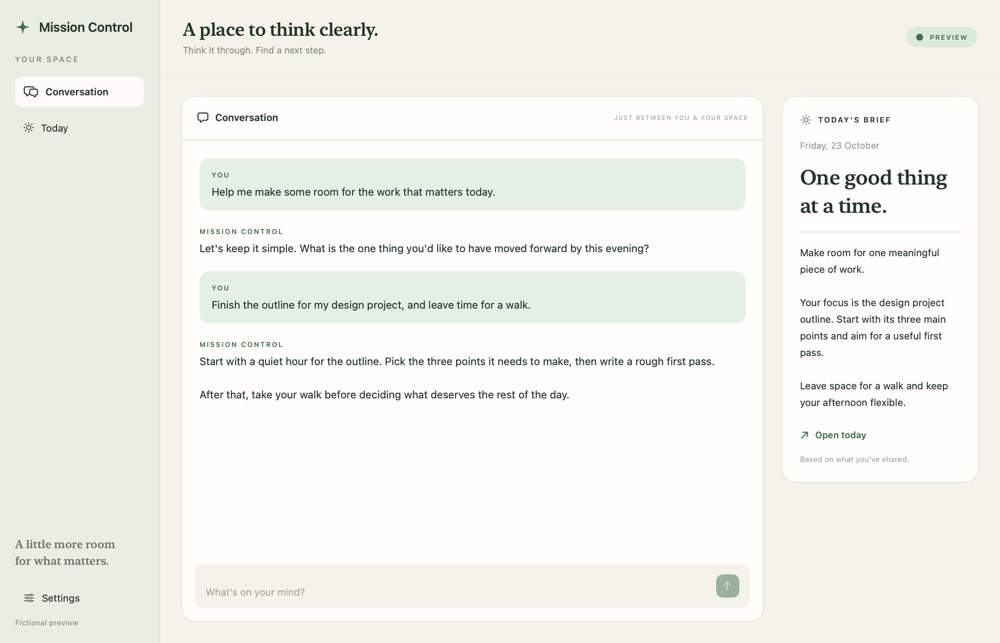

<p align="center"><strong>MISSION CONTROL</strong></p>
<h1 align="center">A space that works the way you do.</h1>
<p align="center">Give this guide to your coding assistant. Choose what matters. Build your own macOS workspace.</p>



**Mission Control helps you and your AI build a personal Mac app.** Start with chat, a simple daily brief and a calm default design. Add Calendar, Reminders, Projects, a Review inbox or background work only if you want them. Choose your own name, too.

The creator calls his personal version **3PO**. Yours can have a different name, different features and a different way of working.

## Start here

1. Browse the [illustrated feature catalogue](docs/FEATURES.md). For a larger preview and a shortlist you can copy, open [the local visual chooser](docs/chooser.html) in your browser after cloning the repo.
2. Open your own copy of this repository in a coding assistant with local file and build access.
3. Give it this prompt:

> Read START_HERE.md. Help me build my own Mission Control on this Mac. Ask a few questions at a time, show me the relevant feature previews, and implement only the features I choose. Use the default design unless I ask for something different. Help me choose a name.

The assistant will interview you, save a specification, build the foundation and add your selected features. You do not need to choose an architecture or understand MCP to begin. A chat without file/build access can help you plan; building and running needs a coding environment on your Mac.

## What you get

| Always available as a starting point | Choose when useful |
| --- | --- |
| Native macOS window, default theme and settings | Apple Calendar and Reminders |
| ChatGPT connection and streaming chat | Projects, notes and local tasks |
| Local, account-separated chat history | Review inbox and prepared actions |
| A daily brief generated when you ask | Heartbeat and scheduled work |
| Your own app name and storage identity | Context pages, Mail, WhatsApp, weather, widgets and MCP integrations |

The foundation is real, buildable code. Optional features have implementation guides and pinned 3PO source to reuse or adapt. They are **not preinstalled modules**, and some need new integration work. Every feature page states its status. Preview illustrations use fictional information; they are not screenshots of someone's personal workspace.

## Try the foundation

On macOS 26+ with full Xcode installed:

```sh
python3 foundation/build.py --run --preview
```

Preview mode uses fictional data and does not load saved accounts, Keychain, app files or live sources. To make your own app, follow [Mac setup](docs/MAC_SETUP.md) or let your coding assistant handle it after the interview.

## Find your way

- [Setup instructions for your coding assistant](START_HERE.md)
- [Illustrated features](docs/FEATURES.md) · [Visual chooser](docs/chooser.html)
- [Mac setup](docs/MAC_SETUP.md) · [ChatGPT connection](docs/CHATGPT.md)
- [What the foundation contains](foundation/README.md)
- [Example specification](examples/workspace-spec.example.json) · [Interview guide](docs/INTERVIEW.md)
- [Adding features and importing future 3PO improvements](docs/MAINTAINING.md)
- [Reference code and provenance](reference/README.md) · [Verification](docs/VERIFICATION.md)

This repository starts private. Making it public later is a separate owner decision. Customer apps should live in their own repositories. See [reuse and publication](docs/REUSE.md) before wider distribution.
