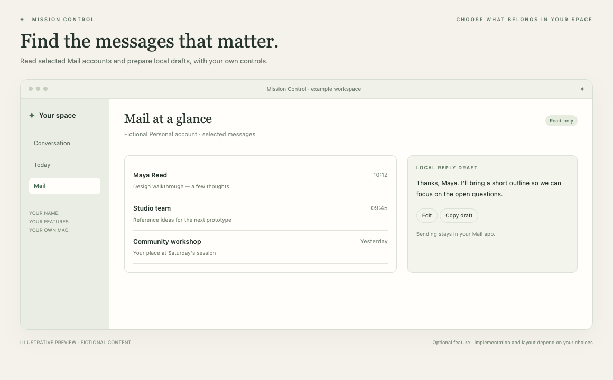

# Choose what belongs in your space

Start with a simple foundation, then add what helps. Your coding assistant will explain the options and implement only your choices. You can add more later.

## The common starting point

**Conversation:** an ongoing chat with local history and your own connected ChatGPT account. **Daily brief:** a short overview generated when you ask, using priorities you enter and recent conversation. Calendar, Reminders and automatic background work are not required. The supplied appearance is applied automatically; you can change it.

This image is a render of the actual foundation with fictional information. The optional feature images below are **illustrations**, not screenshots of a live customer's data or proof of ready-made modules.

Open [the visual chooser](chooser.html) locally for larger previews and a shortlist you can copy to your coding assistant.

## Optional features

### Calendar

See your day without hopping between windows.

Useful if appointments shape your day. Start with a read-only agenda or week view. Editing and dragging are separate choices.

**Reference code available** · Relative implementation size: medium.

[Explore this feature](../features/calendar/README.md)

### Apple Reminders

Bring your existing to-dos into your space.

Useful if Apple Reminders already holds your personal tasks. These are native reminders; Project tasks are a different, optional kind of record.

**Reference code available** · Relative implementation size: medium.

[Explore this feature](../features/reminders/README.md)

### Projects & notes

Give longer work a home, with tasks and notes together.

Useful for work that spans days or weeks: a project, a side business, an application or a creative idea. It works without Apple accounts.

**Reference code available** · Relative implementation size: medium.

[Explore this feature](../features/projects/README.md)

### Review inbox

Consider useful suggestions and choose what happens next.

Useful if you want an assistant to prepare possible next steps for you to inspect. A saved suggestion can have a conversation, a checkbox plan and a clear result.

**Reference code available** · Relative implementation size: advanced.

[Explore this feature](../features/review/README.md)

### Heartbeat

Let your space check in at times you choose.

Useful when you want recurring briefs or suggestions. It performs selected AI work over available inputs; it does not mean every source is connected.

**Reference code available** · Relative implementation size: advanced.

[Explore this feature](../features/heartbeat/README.md)

### Context & memory

Keep useful background available without repeating yourself.

Useful for background you want the assistant to retain: ongoing work, your preferred routines or the meaning of a project. It is distinct from chat history.

**Reference code available** · Relative implementation size: advanced.

[Explore this feature](../features/context/README.md)

### Read-only Mail

Bring relevant messages into view, with drafts you control.

Useful if incoming messages influence your work. Start with selected accounts and read-only lookup. Assessment, drafts and Review are additional choices.

**Reference code available** · Relative implementation size: advanced.

[Explore this feature](../features/mail/README.md)

### Read-only WhatsApp

Include selected conversations in your own workspace.

Useful if selected personal conversations provide relevant context. This optional connector uses an unofficial linked-device helper and can break or face restrictions.

**Reference code available** · Relative implementation size: advanced.

[Explore this feature](../features/whatsapp/README.md)

### Weather

A little local context for planning the day.

Useful if travel, a walk or outdoor plans change with the forecast. Add it as a small standalone view or as optional brief context.

**Reference code available** · Relative implementation size: small.

[Explore this feature](../features/weather/README.md)

### MCP & other integrations

Connect another useful tool when you have a reason to.

Useful when your chosen workflow needs a service beyond the supplied examples. Start with the actual task, then decide whether native code, a direct API or MCP is appropriate.

**Guide; new adapter required** · Relative implementation size: advanced.

[Explore this feature](../features/integrations/README.md)

### Your dashboard

Arrange the information you want to see.

Useful when several selected features deserve their own panels. Start with a fixed tidy layout, then add movable/resizable widgets or multiple pages if wanted.

**Reference code available** · Relative implementation size: medium.

[Explore this feature](../features/widgets/README.md)

## A first version can be very small

Choose chat and a brief, or add one useful connection. You do not need every feature. Review is separate from heartbeat; Projects is separate from Apple Reminders; contextual memory is separate from chat history. A feature's guide explains dependencies and any new access it requires.

[Start the setup conversation](../START_HERE.md) · [Mac setup](MAC_SETUP.md)
