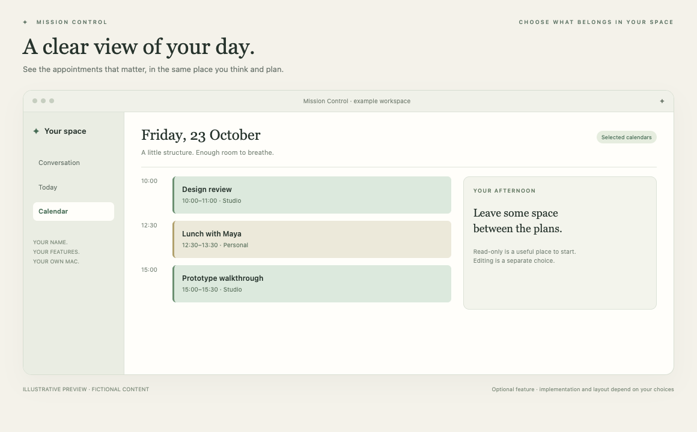

# Calendar

See your day without hopping between windows.

*Illustrative preview, not a live customer screenshot. Optional features require integration into the generated app.*

**Status:** Reference code available. **Implementation size:** medium (a relative guide, not a time promise).

## Is this useful for me?

Useful if appointments shape your day. Start with a read-only agenda or week view. Editing and dragging are separate choices.

You can defer this and add it later. It is not included merely because its reference code is present in this repository.

## What it needs

Calendar permission for the selected capability. No Reminders or Mail permission is implied.

The common foundation supplies account connection, app identity and basic storage. Optional dependencies are choices to explain, not reasons to install every 3PO subsystem.

## Implementation recipe

1. Choose agenda or week layout and the calendars to display. Begin with read access; ask separately about creating or moving events.
2. Adapt EventKit reads and the timeline into an independent Calendar service. Add the selected access-purpose description and stable app signing. Request access only when the owner connects Calendar.
3. Distinguish unavailable access from a genuinely empty day. Preserve timezones, all-day dates and recurrence occurrences.
4. If writes are selected, adapt exact target/revision checks, persistent operation receipts and fresh readback. Never write by matching a title.

## Code to reuse or study

- [EventKitService.swift](../../reference/3po/MissionControl/Sources/Native/EventKitService.swift)
- [NativeSourceRead.swift](../../reference/3po/MissionControl/Sources/Native/NativeSourceRead.swift)
- [CalendarWidgetView.swift](../../reference/3po/MissionControl/Widgets/Calendar/CalendarWidgetView.swift)
- [NativeActionRuntime.swift](../../reference/3po/MissionControl/Infrastructure/Actions/NativeActionRuntime.swift)
- [CalendarTimelineChecks.swift](../../reference/3po/Tests/Widgets/Calendar/CalendarTimelineChecks.swift)

These files describe an integrated reference app at the commit in [the manifest](../../reference/manifest.json). Adapt the relevant behaviour and its tests; do not copy its complete service graph or original signing/storage identities. Some components depend on other 3PO types and will not compile when pasted alone.

## Check that it works

- Denied access shows an unavailable state without inventing an empty day.
- All-day and timed events render correctly across timezone and daylight-saving boundaries.
- If editing is selected, a disposable approved event moves once and readback confirms its exact values; interrupted saves are not replayed.

Use fictional fixtures first, then the owner's explicitly selected source access where needed. Record build, fixture, live account/source and sustained-use results separately. Update the owner's private specification and handover notes.

[Back to the catalogue](../../docs/FEATURES.md) · [Setup workflow](../../START_HERE.md)
