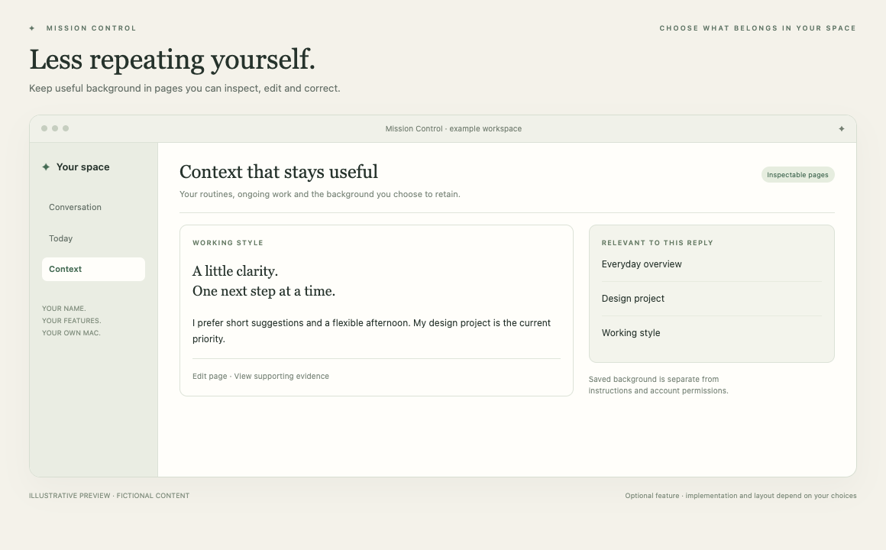

# Context & memory

Keep useful background available without repeating yourself.

*Illustrative preview, not a live customer screenshot. Optional features require integration into the generated app.*

**Status:** Reference code available. **Implementation size:** advanced (a relative guide, not a time promise).

## Is this useful for me?

Useful for background you want the assistant to retain: ongoing work, your preferred routines or the meaning of a project. It is distinct from chat history.

You can defer this and add it later. It is not included merely because its reference code is present in this repository.

## What it needs

Local records and selected model context. Learning from conversations or external sources requires its own chosen controls.

The common foundation supplies account connection, app identity and basic storage. Optional dependencies are choices to explain, not reasons to install every 3PO subsystem.

## Implementation recipe

1. Choose explicit human-owned notes first or AI-maintained context pages. Automatic learning and periodic consolidation are separate opt-ins.
2. Use the current page-first 3PO implementation. Ordinary chat receives a small guide and relevant pages/working changes; avoid reviving the older parallel raw-fact feed.
3. Preserve canonical evidence, corrections/history, source/account ownership and exact identity. Feature instructions remain distinct from factual background.
4. Add inspect, edit, correct and forget controls. If sources or Projects are selected, use their exact access/identity contracts rather than silently importing all data.

## Code to reuse or study

- [ContextPages.swift](../../reference/3po/MissionControl/Memory/Context/ContextPages.swift)
- [ContextPageStore.swift](../../reference/3po/MissionControl/Memory/Context/ContextPageStore.swift)
- [ContextConsolidationRules.swift](../../reference/3po/MissionControl/Memory/Context/ContextConsolidationRules.swift)
- [ContextPagesView.swift](../../reference/3po/MissionControl/Memory/Views/ContextPagesView.swift)
- [ContextPageChecks.swift](../../reference/3po/Tests/Memory/ContextPageChecks.swift)

These files describe an integrated reference app at the commit in [the manifest](../../reference/manifest.json). Adapt the relevant behaviour and its tests; do not copy its complete service graph or original signing/storage identities. Some components depend on other 3PO types and will not compile when pasted alone.

## Check that it works

- The owner can inspect what was supplied to a reply and correct or forget a specific piece of background.
- Another account and unpermitted source evidence cannot enter recall.
- No page learning runs merely because its view opens; selected consolidation is separately controlled.
- Verify relevant context is used without automatically injecting all stored facts.

Use fictional fixtures first, then the owner's explicitly selected source access where needed. Record build, fixture, live account/source and sustained-use results separately. Update the owner's private specification and handover notes.

[Back to the catalogue](../../docs/FEATURES.md) · [Setup workflow](../../START_HERE.md)
