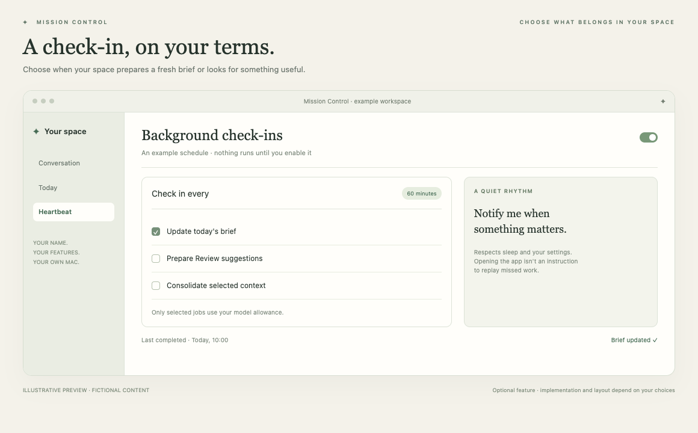

# Heartbeat

Let your space check in at times you choose.

*Illustrative preview, not a live customer screenshot. Optional features require integration into the generated app.*

**Status:** Reference code available. **Implementation size:** advanced (a relative guide, not a time promise).

## Is this useful for me?

Useful when you want recurring briefs or suggestions. It performs selected AI work over available inputs; it does not mean every source is connected.

You can defer this and add it later. It is not included merely because its reference code is present in this repository.

## What it needs

Recurring model usage, explicitly enabled by the owner. Only the selected jobs and sources are started.

The common foundation supplies account connection, app identity and basic storage. Optional dependencies are choices to explain, not reasons to install every 3PO subsystem.

## Implementation recipe

1. Agree the actual jobs, interval, notification style and usage expectations. Leave automatic work off until the owner chooses it.
2. Start with one selected job, such as updating a brief. Adapt durable due-time/run state and the power gate without importing every 3PO learning/review lane.
3. Keep source collection separate. A heartbeat consumes permitted collected snapshots; a source refresh alone makes no AI request.
4. Retain serial ownership, Stop, usage pause, sleep/closed-lid/dark-wake checks and one catch-up after full wake. Avoid replaying every missed interval or retrying failed personal actions.

## Code to reuse or study

- [Heartbeat.swift](../../reference/3po/MissionControl/Background/Heartbeat/Heartbeat.swift)
- [HeartbeatRuntime.swift](../../reference/3po/MissionControl/Background/Heartbeat/HeartbeatRuntime.swift)
- [HeartbeatPower.swift](../../reference/3po/MissionControl/Background/Heartbeat/HeartbeatPower.swift)
- [HeartbeatService.swift](../../reference/3po/MissionControl/Background/Heartbeat/HeartbeatService.swift)

These files describe an integrated reference app at the commit in [the manifest](../../reference/manifest.json). Adapt the relevant behaviour and its tests; do not copy its complete service graph or original signing/storage identities. Some components depend on other 3PO types and will not compile when pasted alone.

## Check that it works

- A fictional clock produces one due run and no run while disabled or already busy.
- Sleep interruption preserves due state; full wake catches up once without a retry storm.
- A failed selected lane preserves completed outcomes and schedules a fresh future cycle.
- Perform a real sleep/wake acceptance check separately before claiming ordinary-use reliability.

Use fictional fixtures first, then the owner's explicitly selected source access where needed. Record build, fixture, live account/source and sustained-use results separately. Update the owner's private specification and handover notes.

[Back to the catalogue](../../docs/FEATURES.md) · [Setup workflow](../../START_HERE.md)
