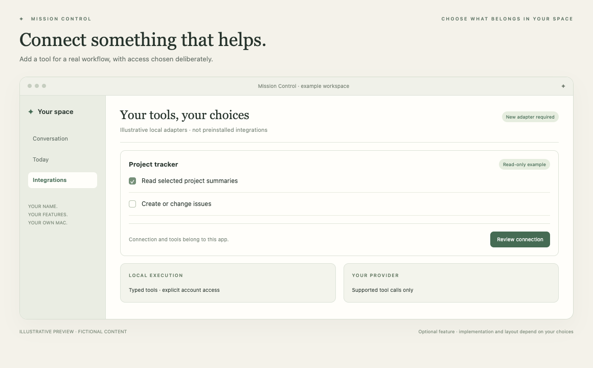

# MCP & other integrations

Connect another useful tool when you have a reason to.

*Illustrative preview, not a live customer screenshot. Optional features require integration into the generated app.*

**Status:** Guide; new adapter required. **Implementation size:** advanced (a relative guide, not a time promise).

## Is this useful for me?

Useful when your chosen workflow needs a service beyond the supplied examples. Start with the actual task, then decide whether native code, a direct API or MCP is appropriate.

You can defer this and add it later. It is not included merely because its reference code is present in this repository.

## What it needs

Depends on the chosen service. This recipe is guidance for new integration work, not a prebuilt MCP module.

The common foundation supplies account connection, app identity and basic storage. Optional dependencies are choices to explain, not reasons to install every 3PO subsystem.

## Implementation recipe

1. Identify the service, intended read/write operations, supported authentication and where its connector will run.
2. Distinguish the coding assistant's tools from the finished app's runtime. A plugin installed in Claude/Codex does not install it into a new app.
3. Implement a local client/adapter for the chosen service. The 3PO tool protocol/session illustrates typed execution boundaries, not a complete generic MCP client.
4. Expose only selected tools, validate schemas/owners/capabilities and keep secrets in an appropriate credential store. For writes, add exact authority, durable receipts and saved-outcome verification.
5. Check current service and MCP documentation, and the ChatGPT subscription route's supported tools. Do not assume provider-hosted connectors are available.

## Code to reuse or study

- [PAToolProtocol.swift](../../reference/3po/MissionControl/Assistant/Tools/PAToolProtocol.swift)
- [PAToolSession.swift](../../reference/3po/MissionControl/Assistant/Tools/PAToolSession.swift)
- [PAToolAuthorization.swift](../../reference/3po/MissionControl/Assistant/Tools/PAToolAuthorization.swift)

These files describe an integrated reference app at the commit in [the manifest](../../reference/manifest.json). Adapt the relevant behaviour and its tests; do not copy its complete service graph or original signing/storage identities. Some components depend on other 3PO types and will not compile when pasted alone.

## Check that it works

- Only selected tools appear in the app's actual runtime tool list.
- Revoked/expired authorization and unavailable services produce clear bounded failures.
- Read-only tools cannot dispatch writes. Approved writes are verified and uncertain results are not replayed.
- The app works when the developer's coding assistant is closed.

Use fictional fixtures first, then the owner's explicitly selected source access where needed. Record build, fixture, live account/source and sustained-use results separately. Update the owner's private specification and handover notes.

[Back to the catalogue](../../docs/FEATURES.md) · [Setup workflow](../../START_HERE.md)
