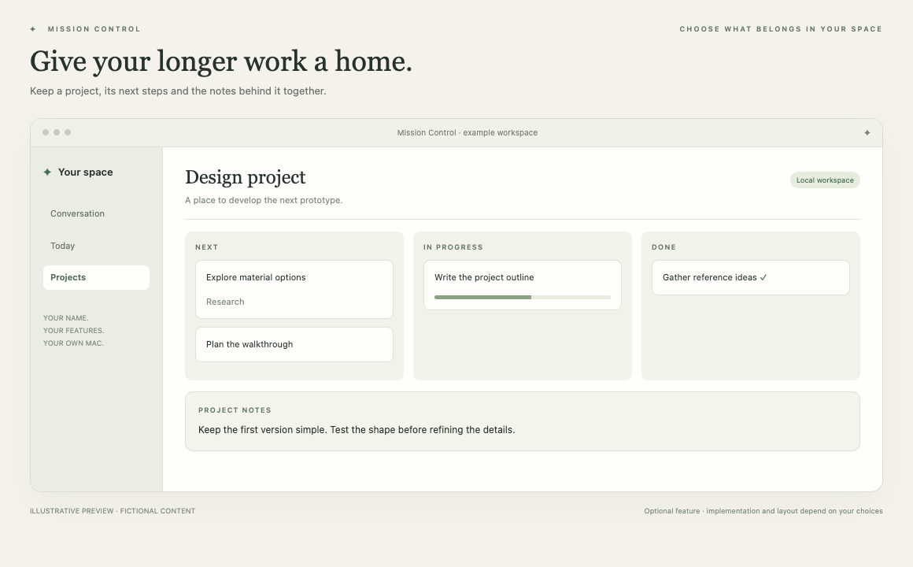

# Projects & notes

Give longer work a home, with tasks and notes together.

*Illustrative preview, not a live customer screenshot. Optional features require integration into the generated app.*

**Status:** Reference code available. **Implementation size:** medium (a relative guide, not a time promise).

## Is this useful for me?

Useful for work that spans days or weeks: a project, a side business, an application or a creative idea. It works without Apple accounts.

You can defer this and add it later. It is not included merely because its reference code is present in this repository.

## What it needs

Local app storage only. No Calendar, Reminders or external account is required.

The common foundation supplies account connection, app identity and basic storage. Optional dependencies are choices to explain, not reasons to install every 3PO subsystem.

## Implementation recipe

1. Start with local spaces, tasks and notes. Choose a simple list, board or both. Use the foundation account/storage identity.
2. Adapt the workspace model and persistence before mounting views. Keep IDs and hierarchy stable; separate Project tasks from Apple Reminders.
3. Expose only selected project tools to the assistant. The human owns project creation and changes; mentioning an idea in chat does not automatically create a project.
4. Add reversible local edits and exact parent/revision checks. Preserve folder defaults, ordering and recently deleted identities.

## Code to reuse or study

- [LifeWorkspace.swift](../../reference/3po/MissionControl/Projects/LifeWorkspace.swift)
- [LifeWorkspaceStore.swift](../../reference/3po/MissionControl/Projects/LifeWorkspaceStore.swift)
- [LifeProjectWidget.swift](../../reference/3po/MissionControl/Projects/LifeProjectWidget.swift)
- [LifeProjectNotes.swift](../../reference/3po/MissionControl/Projects/LifeProjectNotes.swift)
- [LifeWorkspaceTools.swift](../../reference/3po/MissionControl/Projects/LifeWorkspaceTools.swift)
- [LifeWorkspaceChecks.swift](../../reference/3po/Tests/Projects/LifeWorkspaceChecks.swift)

These files describe an integrated reference app at the commit in [the manifest](../../reference/manifest.json). Adapt the relevant behaviour and its tests; do not copy its complete service graph or original signing/storage identities. Some components depend on other 3PO types and will not compile when pasted alone.

## Check that it works

- A space, child task and note reopen under the same account and identities.
- A second account cannot see or mutate the first account's project records.
- Moving a task, undoing and restoring a deleted item preserve its intended parent and ID.

Use fictional fixtures first, then the owner's explicitly selected source access where needed. Record build, fixture, live account/source and sustained-use results separately. Update the owner's private specification and handover notes.

[Back to the catalogue](../../docs/FEATURES.md) · [Setup workflow](../../START_HERE.md)
