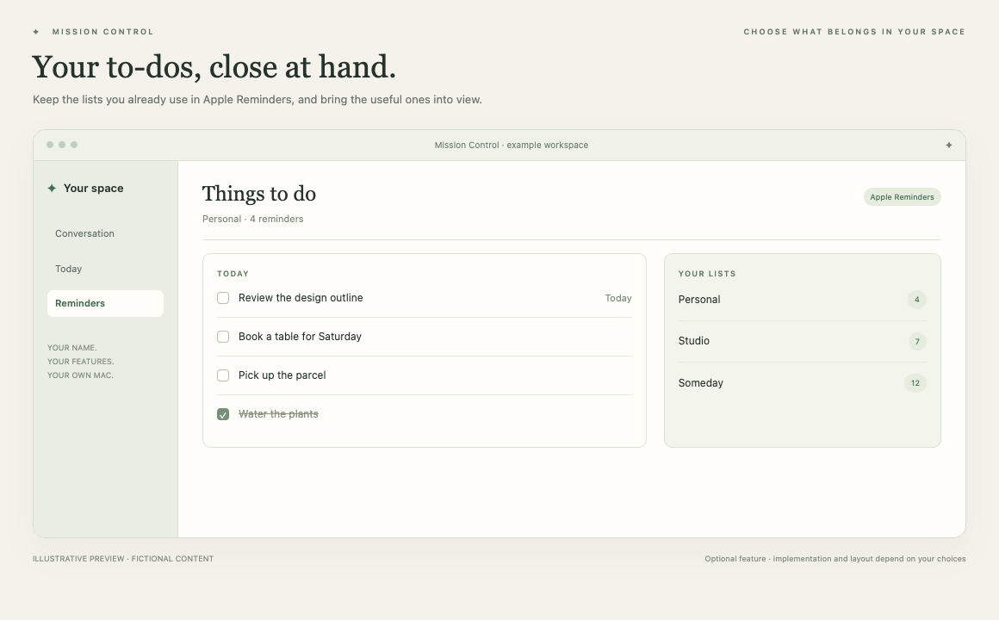

# Apple Reminders

Bring your existing to-dos into your space.

*Illustrative preview, not a live customer screenshot. Optional features require integration into the generated app.*

**Status:** Reference code available. **Implementation size:** medium (a relative guide, not a time promise).

## Is this useful for me?

Useful if Apple Reminders already holds your personal tasks. These are native reminders; Project tasks are a different, optional kind of record.

You can defer this and add it later. It is not included merely because its reference code is present in this repository.

## What it needs

Reminders permission. Calendar and Projects are not required.

The common foundation supplies account connection, app identity and basic storage. Optional dependencies are choices to explain, not reasons to install every 3PO subsystem.

## Implementation recipe

1. Choose lists and whether the first version can only read, or can also create/complete reminders on explicit requests.
2. Adapt the reminder service into its own selected source. Add its usage description and permission request at connection time.
3. Retain list IDs, date-only versus timed due dates, completion state and recurrence semantics. Do not convert date-only reminders into midnight appointments.
4. For selected writes, issue exact current identities, validate captured fields, save a pending receipt and verify by readback. Expose supported Undo honestly.

## Code to reuse or study

- [EventKitService.swift](../../reference/3po/MissionControl/Sources/Native/EventKitService.swift)
- [EventKitTools.swift](../../reference/3po/MissionControl/Sources/Native/EventKitTools.swift)
- [NativeEditing.swift](../../reference/3po/MissionControl/Infrastructure/Actions/NativeEditing.swift)
- [NativeCreationStore.swift](../../reference/3po/MissionControl/Infrastructure/Actions/NativeCreationStore.swift)

These files describe an integrated reference app at the commit in [the manifest](../../reference/manifest.json). Adapt the relevant behaviour and its tests; do not copy its complete service graph or original signing/storage identities. Some components depend on other 3PO types and will not compile when pasted alone.

## Check that it works

- Permission denial and an empty list remain distinct.
- Completing an approved fictional/disposable reminder changes only that exact record.
- Date-only and recurring reminders survive reopen with the same intended date and scope.

Use fictional fixtures first, then the owner's explicitly selected source access where needed. Record build, fixture, live account/source and sustained-use results separately. Update the owner's private specification and handover notes.

[Back to the catalogue](../../docs/FEATURES.md) · [Setup workflow](../../START_HERE.md)
