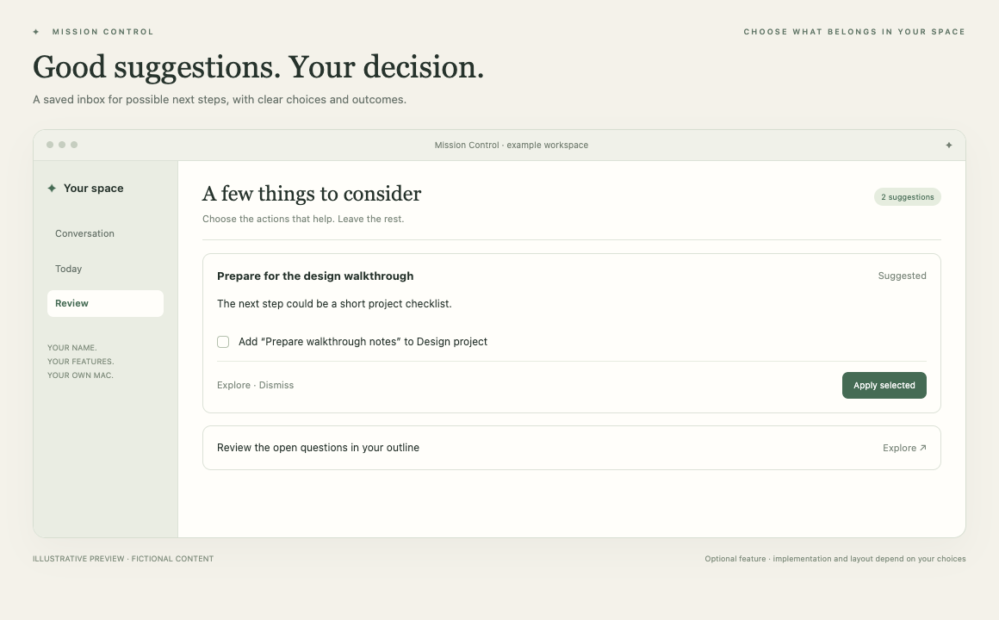

# Review inbox

Consider useful suggestions and choose what happens next.

*Illustrative preview, not a live customer screenshot. Optional features require integration into the generated app.*

**Status:** Reference code available. **Implementation size:** advanced (a relative guide, not a time promise).

## Is this useful for me?

Useful if you want an assistant to prepare possible next steps for you to inspect. A saved suggestion can have a conversation, a checkbox plan and a clear result.

You can defer this and add it later. It is not included merely because its reference code is present in this repository.

## What it needs

Depends on the chosen suggestion source and action destination. Email, Projects and heartbeat are possible companions, not mandatory bundles.

The common foundation supplies account connection, app identity and basic storage. Optional dependencies are choices to explain, not reasons to install every 3PO subsystem.

## Implementation recipe

1. Choose the kinds of suggestions to prepare and their actual sources. Manual generation is a valid first version; heartbeat is optional.
2. Create a persistent inbox with exact proposal identities, action payloads, selection state and outcomes. Reading saved cards must not start AI work.
3. Separate proposal creation from approving displayed concrete actions. Apply only the selected exact actions under the current source/account and destination permissions.
4. Adapt canonical receipts, duplicate grouping, never-started job recovery and outcome display. Uncertain or interrupted writes require outcome checking rather than blind replay.

## Code to reuse or study

- [PreparedReview.swift](../../reference/3po/MissionControl/Review/Inbox/PreparedReview.swift)
- [ProactiveService.swift](../../reference/3po/MissionControl/Review/Inbox/ProactiveService.swift)
- [ReviewWork.swift](../../reference/3po/MissionControl/Review/Actions/ReviewWork.swift)
- [ReviewPlanDashboardAdapter.swift](../../reference/3po/MissionControl/Review/Actions/ReviewPlanDashboardAdapter.swift)
- [ActionReceiptStore.swift](../../reference/3po/MissionControl/Infrastructure/Actions/ActionReceiptStore.swift)

These files describe an integrated reference app at the commit in [the manifest](../../reference/manifest.json). Adapt the relevant behaviour and its tests; do not copy its complete service graph or original signing/storage identities. Some components depend on other 3PO types and will not compile when pasted alone.

## Check that it works

- Opening the inbox displays saved cards with zero inference requests.
- Approving a selected concrete action executes it once and shows a verified result.
- Dismiss/Undo, reopen and duplicate proposals retain their expected state; an uncertain save cannot be replayed automatically.

Use fictional fixtures first, then the owner's explicitly selected source access where needed. Record build, fixture, live account/source and sustained-use results separately. Update the owner's private specification and handover notes.

[Back to the catalogue](../../docs/FEATURES.md) · [Setup workflow](../../START_HERE.md)
