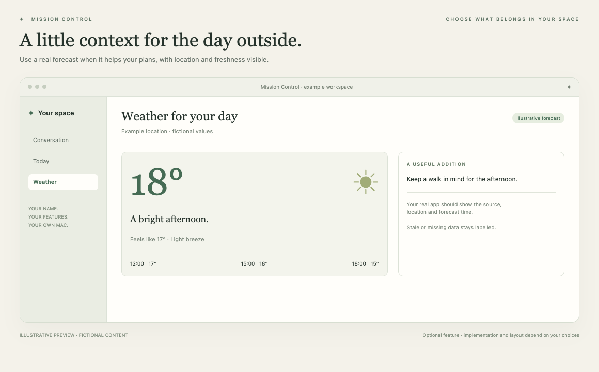

# Weather

A little local context for planning the day.

*Illustrative preview, not a live customer screenshot. Optional features require integration into the generated app.*

**Status:** Reference code available. **Implementation size:** small (a relative guide, not a time promise).

## Is this useful for me?

Useful if travel, a walk or outdoor plans change with the forecast. Add it as a small standalone view or as optional brief context.

You can defer this and add it later. It is not included merely because its reference code is present in this repository.

## What it needs

Network forecast access; location permission only if selected. Check the current forecast provider terms and attribution before distribution.

The common foundation supplies account connection, app identity and basic storage. Optional dependencies are choices to explain, not reasons to install every 3PO subsystem.

## Implementation recipe

1. Let the owner choose a manual location or optional location permission. Do not infer an address from unrelated personal records.
2. Adapt the weather service and cache with its own explicit refresh. Weather refresh need not invoke the assistant.
3. Show location, forecast date/time and cached/stale state. Include weather in briefs only when current data is actually supplied.

## Code to reuse or study

- [WeatherService.swift](../../reference/3po/MissionControl/Sources/Weather/WeatherService.swift)
- [WeatherWidgetView.swift](../../reference/3po/MissionControl/Sources/Weather/WeatherWidgetView.swift)
- [Weather.swift](../../reference/3po/MissionControl/Sources/Weather/Weather.swift)

These files describe an integrated reference app at the commit in [the manifest](../../reference/manifest.json). Adapt the relevant behaviour and its tests; do not copy its complete service graph or original signing/storage identities. Some components depend on other 3PO types and will not compile when pasted alone.

## Check that it works

- A fixture forecast renders dates, units and location correctly.
- Unavailable or stale weather is labelled and never fabricated by the model.
- Refreshing weather triggers no AI request.

Use fictional fixtures first, then the owner's explicitly selected source access where needed. Record build, fixture, live account/source and sustained-use results separately. Update the owner's private specification and handover notes.

[Back to the catalogue](../../docs/FEATURES.md) · [Setup workflow](../../START_HERE.md)
