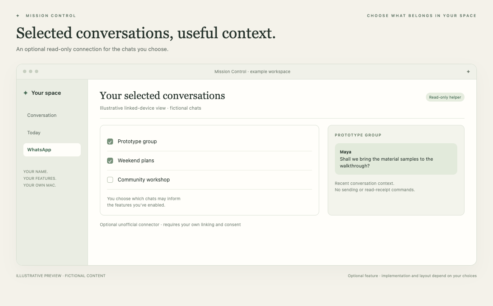

# Read-only WhatsApp

Include selected conversations in your own workspace.

*Illustrative preview, not a live customer screenshot. Optional features require integration into the generated app.*

**Status:** Reference code available. **Implementation size:** advanced (a relative guide, not a time promise).

## Is this useful for me?

Useful if selected personal conversations provide relevant context. This optional connector uses an unofficial linked-device helper and can break or face restrictions.

You can defer this and add it later. It is not included merely because its reference code is present in this repository.

## What it needs

Optional unofficial Baileys helper, Node/npm during preparation and human QR consent. No other source is required.

The common foundation supplies account connection, app identity and basic storage. Optional dependencies are choices to explain, not reasons to install every 3PO subsystem.

## Implementation recipe

1. Explain the linked-device approach and confirm the owner wants it. Let them scan their own QR code and choose chats; never reuse another app's session.
2. Adapt the separate helper package, pinned runtime packaging and encrypted session/message/name storage. Give the new app its own helper/storage/Keychain identities.
3. Keep chat selection and AI-purpose permissions explicit. Reception may cache unselected text; explain this distinction instead of promising selection limits reception.
4. Keep the helper read-only: no sending, presence changes or read-receipt commands. Stop it when disconnected; do not silently relink or expand chats.

## Code to reuse or study

- [WhatsAppService.swift](../../reference/3po/MissionControl/Sources/WhatsApp/WhatsAppService.swift)
- [WhatsAppSourcePicker.swift](../../reference/3po/MissionControl/Sources/WhatsApp/WhatsAppSourcePicker.swift)
- [reader.mjs](../../reference/3po/WhatsAppBridge/reader.mjs)
- [policy.mjs](../../reference/3po/WhatsAppBridge/policy.mjs)
- [package-whatsapp-runtime.py](../../reference/3po/scripts/packaging/package-whatsapp-runtime.py)

These files describe an integrated reference app at the commit in [the manifest](../../reference/manifest.json). Adapt the relevant behaviour and its tests; do not copy its complete service graph or original signing/storage identities. Some components depend on other 3PO types and will not compile when pasted alone.

## Check that it works

- The owner completes linking and the selected chat list matches their choice.
- Fictional helper tests reject write/read-receipt/presence commands.
- Account changes and disconnection invalidate old source access; local sessions stay separate from 3PO.
- Missing or partial history is labelled honestly.

Use fictional fixtures first, then the owner's explicitly selected source access where needed. Record build, fixture, live account/source and sustained-use results separately. Update the owner's private specification and handover notes.

[Back to the catalogue](../../docs/FEATURES.md) · [Setup workflow](../../START_HERE.md)
