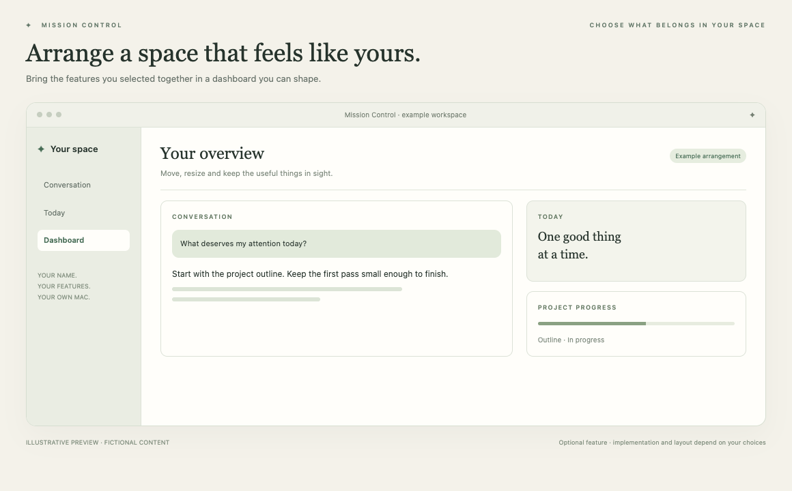

# Your dashboard

Arrange the information you want to see.

*Illustrative preview, not a live customer screenshot. Optional features require integration into the generated app.*

**Status:** Reference code available. **Implementation size:** medium (a relative guide, not a time promise).

## Is this useful for me?

Useful when several selected features deserve their own panels. Start with a fixed tidy layout, then add movable/resizable widgets or multiple pages if wanted.

You can defer this and add it later. It is not included merely because its reference code is present in this repository.

## What it needs

Local appearance/layout storage. Individual widgets use only the permissions of their selected feature.

The common foundation supplies account connection, app identity and basic storage. Optional dependencies are choices to explain, not reasons to install every 3PO subsystem.

## Implementation recipe

1. Ask which selected features should be visible together. Retain default spacing, typography and colours unless the owner asks for another style.
2. Adapt saved pages/widget identities and layout geometry independently from source services. Adding a panel must not implicitly connect its source.
3. Mount only selected widget kinds. Preserve layout state across edits, resize and reopening; an absent feature must not start a hidden service.
4. Support keyboard navigation, readable contrast and light/dark appearance. Choose whether saved themes and drag editing are needed in the first version.

## Code to reuse or study

- [WorkspaceModels.swift](../../reference/3po/MissionControl/Dashboard/WorkspaceModels.swift)
- [WorkspaceStore.swift](../../reference/3po/MissionControl/Dashboard/WorkspaceStore.swift)
- [WorkspaceView.swift](../../reference/3po/MissionControl/Dashboard/WorkspaceView.swift)
- [WorkspaceColors.swift](../../reference/3po/MissionControl/Dashboard/WorkspaceColors.swift)

These files describe an integrated reference app at the commit in [the manifest](../../reference/manifest.json). Adapt the relevant behaviour and its tests; do not copy its complete service graph or original signing/storage identities. Some components depend on other 3PO types and will not compile when pasted alone.

## Check that it works

- Reordering/resizing and reopening retain the layout and stable IDs.
- Showing, hiding and editing a widget do not change source permissions or create AI requests.
- Narrow windows, long titles and light/dark modes remain usable.

Use fictional fixtures first, then the owner's explicitly selected source access where needed. Record build, fixture, live account/source and sustained-use results separately. Update the owner's private specification and handover notes.

[Back to the catalogue](../../docs/FEATURES.md) · [Setup workflow](../../START_HERE.md)
