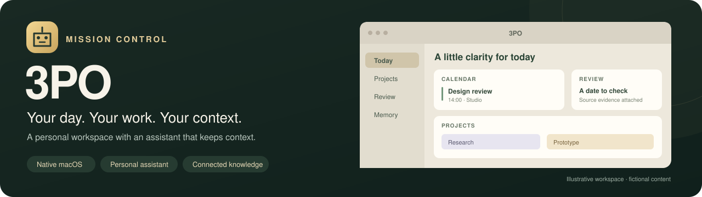
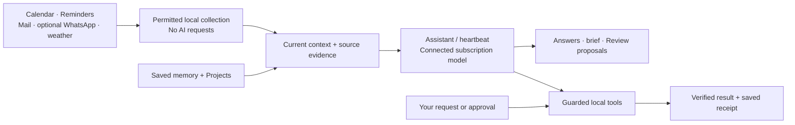

<p align="center">
  
</p>

<p align="center">
  <strong>A native macOS workspace with a personal assistant that keeps context.</strong><br>
  Calendar, Reminders, read-only communications, projects and inspectable memory, together.
</p>

<p align="center">
  <a href="docs/guides/FEATURES.md">Explore the features</a> ·
  <a href="docs/architecture/ARCHITECTURE.md">Understand the architecture</a> ·
  <a href="docs/guides/GETTING_STARTED.md">Build and get started</a> ·
  <a href="docs/README.md">Documentation</a>
</p>

---

**3PO** is the current product name; **Mission Control** is the codebase and stable storage identity. Built with SwiftUI and SwiftData for **macOS 26+**, it combines a customisable dashboard with an ongoing assistant conversation powered by a connected ChatGPT subscription. This repository is a development project, with source, focused checks and implementation documentation. It is not a packaged public release.

## One place for the day and the longer view

| Your day | Your work | Your context |
| --- | --- | --- |
| Calendar and Reminders, a current brief, weather and a Review inbox | Nested spaces, notes and local tasks with boards, deadlines and progress | One PA conversation, versioned memories, source evidence and inspectable context |

- **Arrange your workspace.** Saved pages, movable/resizable widgets, focused viewing, independent light/dark palettes and named colour themes.
- **Ask naturally.** Follow-ups, pasted screenshots, optional Life-area Focus, a dedicated setup interview and explicit queued work.
- **Review what matters.** Email assessments and supported proposals share a card, with one saved checkbox/conversation sheet, direct Done approval without AI, local drafts, Dismiss and editable feedback preferences.
- **See action outcomes.** Accepted never-started Review jobs run when idle; Activity shows five recent tasks. Verified success appears green for six seconds, with unresolved questions and failures retaining attention.
- **Keep useful knowledge.** Inspect facts, corrections and evidence; preview which memories a question retrieves; connect memory to your existing projects.
- **Make supported changes.** Native Calendar/Reminders operations and local project edits check exact identities, current revisions and saved results.

Read the [feature guide](docs/guides/FEATURES.md) for controls, examples and the limits of each feature.

## How the pieces fit



The app owns continuity, source permissions, evidence and action checks. The model supplies language and reasoning through a replaceable inference boundary. **Apple apps remain the source of truth.** Background proposals need human approval before native changes; imported messages and memory never independently authorise a write.

The [architecture guide](docs/architecture/ARCHITECTURE.md) follows a message, a heartbeat and a native edit through the actual components, then explains storage and recovery.

## A useful distinction: refresh versus heartbeat

| Action | What it does | Uses AI? |
| --- | --- | --- |
| **Refresh sources only** · ⌥⌘R | Updates permitted local source caches | No |
| **Run heartbeat** · ⌘R | Reviews already collected communications, prepares suggestions and updates the brief | Yes, when connected and permitted |
| **Send a PA message** | Works on your explicit request with relevant context and local tools | Yes |

Mail collects independently, normally polling every five minutes. A heartbeat uses collected Mail rather than forcing another poll. Scheduled work waits during system sleep, closed-lid operation or dark wake and checks once when due after full wake. Completed work survives a failed run; the next interval starts a fresh cycle. [Background behaviour](docs/guides/FEATURES.md#heartbeat-and-background-work) explains the controls and recovery.

## Build and explore

Requires macOS 26+, Xcode at `/Applications/Xcode.app`, Python 3, npm and a development Node installation. Initial dependency/runtime downloads need internet. The current signing team is developer-specific; see [setup and signing](docs/guides/GETTING_STARTED.md#build-from-source) before building on another Mac.

```sh
MISSIONCONTROL_BUILD_ROOT=/private/tmp/3po-docs-example ./scripts/build.sh
open /private/tmp/3po-docs-example/derived-data/Build/Products/Debug/3PO.app --args --sample
```

The explicit build root makes the output predictable; by default each build gets a unique temporary directory. `--sample` opens a fictional DEBUG dashboard with normal source collection and automatic scheduling bypassed. It still shares existing app storage and Keychain. For normal use and account/source setup, follow [Getting started](docs/guides/GETTING_STARTED.md). The build bundles a checksum-pinned Node runtime for optional WhatsApp, so the installed app does not need a separate Node installation.

## Privacy and control

Mail and WhatsApp are **read-only**. Reply drafts stay local for review, editing, saving and copying. Calendar, Reminders, Mail Automation and optional location/dictation use macOS permissions. Separate AI/source controls determine which personal context can be sent to the connected provider. Memory use, source learning and background work have their own controls. Review permission may also enable bounded source learning under the global controls; newly permitted sources baseline existing content.

Local records live under `~/Library/Application Support/Mission Control`; credentials and encryption keys use Keychain. WhatsApp sessions, messages, names and source choices are encrypted locally. This does not mean every SwiftData record is encrypted. Personal records, credentials, caches, QR codes and screenshots stay outside Git. The optional WhatsApp connector uses unofficial Baileys and can break or face restrictions. [Privacy and source boundaries](docs/guides/PRIVACY.md) explains storage and what leaves the Mac.

## Checks and current limits

The repository includes deterministic checks with fictional data, alongside separate signed-app, native-fixture and model-evaluation tiers. A passing fixture, build, installation and actual-model quality are separate claims; source-free checks do not establish sustained reliability in ordinary use. The [developer guide](docs/development/DEVELOPMENT.md#choose-the-right-checks) explains how to run and interpret them.

Memory retrieval currently uses local lexical selection and typed links. Broad semantic/paraphrase recall and local offline inference are not implemented.

## Read or contribute

| To understand… | Start here |
| --- | --- |
| The product and its controls | [Feature guide](docs/guides/FEATURES.md) |
| Services, data flow and ownership | [Architecture](docs/architecture/ARCHITECTURE.md) |
| Memory selection, evidence and corrections | [Memory and context](docs/architecture/MEMORY_AND_CONTEXT.md) |
| Spaces, tasks, notes and links | [Project workspace](docs/architecture/PROJECT_WORKSPACE.md) |
| Setup, checks and source navigation | [Getting started](docs/guides/GETTING_STARTED.md) · [Developer guide](docs/development/DEVELOPMENT.md) |
| The full reading map | [Documentation index](docs/README.md) |

The shipped assistant's behaviour lives in application code and runtime prompts. The developer guide maps those components and their checks.

## Repository layout

`MissionControl/` groups app code by responsibility: App, Dashboard, Assistant, Memory, Projects, Review, Background, Sources, Widgets, Infrastructure and Development. `Tests/` follows the same areas. `WhatsAppBridge/` remains its own helper package.

Use `scripts/build.sh` and `scripts/check.sh` from the repository root. Component checks live in `scripts/checks/`; project generation, assets and packaging helpers have their own script folders. [The developer guide](docs/development/DEVELOPMENT.md) explains the commands and maps the main components.

[Documentation](docs/README.md) is grouped into setup and feature guides, architecture references and build/test documentation.
