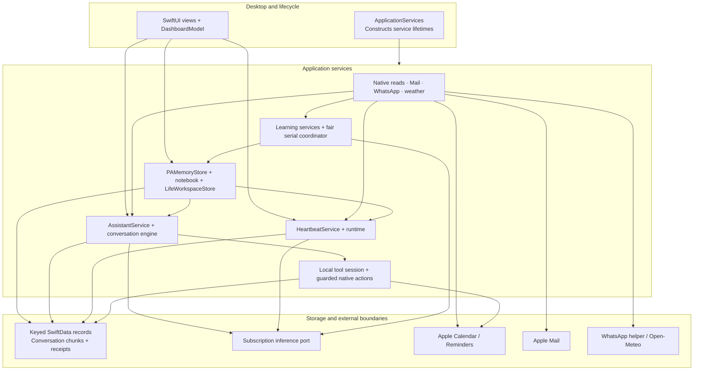
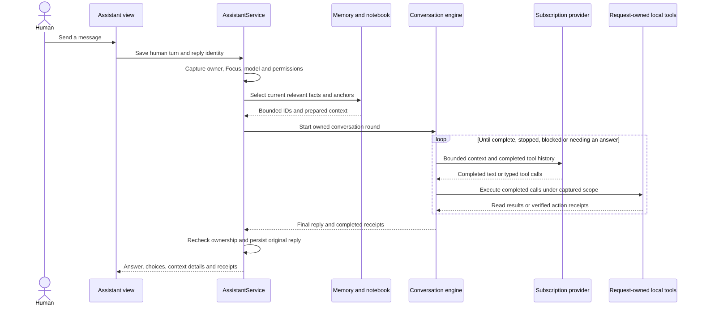
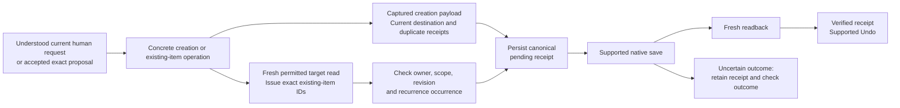
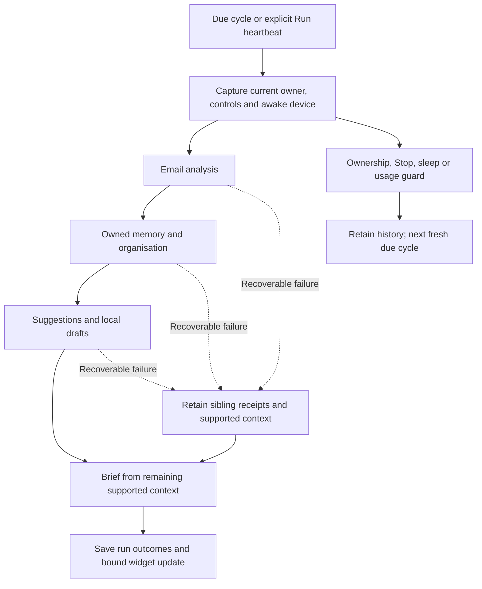

# Architecture

**3PO owns the context and the safeguards; the connected model supplies language and reasoning.** The desktop presents one workspace, but source collection, assistant execution, memory, Projects, learning, native actions and heartbeat scheduling have separate owners.

[Documentation](../README.md) · [Feature guide](../guides/FEATURES.md) · [Source map](../development/DEVELOPMENT.md#find-your-way-around-the-code)

This guide explains the service boundaries and data flow. The [developer guide](../development/DEVELOPMENT.md#choose-the-right-checks) distinguishes deterministic checks, signed-app checks and real-source/model evaluation.

## The system at a glance

Arrows show calls or supplied context, not unrestricted access. Source services enforce permitted, bounded reads; desktop adapters supply narrower runtime ports to the core services. Apple owns native records. Projects owns local work. The notebook/map is a derived view of existing memory and workspace identities.

## Who owns what

| Layer | Main components | Responsibility |
| --- | --- | --- |
| Desktop | `DashboardModel`, `WorkspaceView`, feature views | Navigation, mounted widgets, forms, layout, feedback and lifecycle hooks |
| Composition | `ApplicationServices` | Constructs production services; construction alone does not start collection or inference |
| Conversation | `AssistantService`, `AssistantRuntime`, `AssistantDashboardAdapter`, `PAConversationEngine` | Captured request, draft, Focus/setup/queue state, preparation, completed tool rounds and persisted replies |
| Provider | `PAInferenceConnection`, `ChatGPTConnection`, `ChatGPTStream` | Narrow inference protocol, registration/renewal and streaming subscription transport |
| Sources | `EventKitService`, `NativeSourceReading`, `MailService`, `WhatsAppService`, `WeatherService` | Current source identity, availability, cache and bounded reads; native read port is distinct from write operations |
| Memory | `PAMemoryStore`, `PAMemory`, `LifeNotebook`, `LifeCanonicalNotebook` | Evidence, belief versions, usable records, deterministic recall and canonical workspace anchors |
| Projects | `LifeWorkspaceStore`, `LifeWorkspaceTools`, `LifeWorkspaceContext` | Human-owned spaces/tasks, notes, stages, hierarchy, exact bindings and tombstones |
| Learning | `LearningRuntime`, five learning services, `BackgroundLearningCoordinator`, `LearningBudget` | Separately controlled learning, persisted claims, bounded batches, shared allowance and fair serial scheduling |
| Review and briefs | `EmailSummaryService` (including `ReviewFeedbackService` extensions and `ReviewFeedbackJobs`), `ProactiveService`, `BriefingService` | Email attention, evidence-linked proposals, explicit feedback interpretation and current brief |
| Review execution | `ReviewWorkService`, `ReviewWorkDashboardAdapter`, `ReviewPlanDashboardAdapter` | Saved source conversations and checkbox plans, serial accepted jobs, shared canonical action identities and receipts |
| Activity | `AIActivityStore`, `AIActivityDashboardAdapter`, `AIActivityView` | Current action work and five recent task outcomes; local attention and six-second verified success expiry without streamed-prose observation |
| Scheduled work | `HeartbeatService`, `HeartbeatRuntime`, `HeartbeatDashboardAdapter` | Due time, power gate, run identity, call claims, stage history and fresh-cycle recovery |
| Writes | `AssistantActions`, `NativeActionRuntime`, `ActionReceiptStore`, `NativeCreationStore` | Current human authority, exact targets, pending receipts, native execution, readback and supported Undo |
| Persistence | `LocalRecordRepository`, `ConversationRepository` | Fresh-context keyed transactions; atomic conversation metadata and changed 64-turn chunks |

Follow the [developer source map](../development/DEVELOPMENT.md#find-your-way-around-the-code) for file links. The runtime ports allow fictional providers, sources, clocks and storage in tests without constructing the dashboard or reading personal accounts.

## A message becoming an answer

Memory usability precedes relevance: account/scope, current belief, consent, source support and age must pass before ranking. A targeted query can return **zero facts**. Focus helps relevance within the captured scope; it cannot grant permission or widen an unrelated query. The notebook uses the same selected fact IDs and relevant project anchors. It does not add every saved life fact.

The engine executes completed typed calls, including the supported completed-item fallback, rather than partial streamed arguments. Complete transport rounds and encrypted provider reasoning support continuation. Older completed transport rounds may be pruned when input needs room; stored operation identities and verified receipts remain. Duplicate/stalled loops, Stop, provider failure and ownership changes terminate the captured work. There is no fixed foreground tool-count cap.

New replies record prepared IDs/counts, model, Focus and attempted tool names in **Context details**. That trace describes supplied context, not model attention, private reasoning or proof of a successful write.

## A supported native change

The request-owned tool session separates **read-issued IDs** from **mutation-issued authority**. Knowing an ID is insufficient to authorise a change.

Ordinary pronouns and confirmations can express intent. Missing essential dates, destination or recurrence scope require a short clarification. Imported email, source memory and old model output are evidence rather than independent permission.

Known pre-save Calendar/Reminders read prerequisites can trigger one permitted read and one retry of the unchanged request. An uncertain save is never blindly repeated. Native deletion and unsupported series changes have no app Undo. Direct human Calendar dragging is a separate UI path: it previews continuously and saves one guarded, duration-preserving, fifteen-minute-snapped occurrence change on release. Background proposals still need approval.

## Saved Review and explicit feedback

Explore opens a saved source/account conversation and checkbox plan without inference or source-body reconstruction. Done executes the checked concrete payloads without AI, preserving an unsent draft. Immediate conversational execution shares canonical identities and receipts with Done. Creation approval validates source/account access, captured payload, destination, duplicate/uncertain receipts and readback; existing-item edits/removals retain exact target, current-field and occurrence checks.

Accepted never-started Review jobs run serially when idle, including after reopening. Stop, failure or an unanswered question affects that request rather than pausing unrelated accepted work. Attempted/interrupted work and uncertain saves require explicit recovery. The general delegated conversation queue retains its separate explicit continuation contract.

Explicit email feedback queues for the next heartbeat, at most one submission per cycle, with Process now for immediate priority. Interpretation captures source choices and exact email/account/assessment, model, memory, storage and cancellation ownership, with Mail body readback before saving. Unrelated EventKit notifications do not invalidate it. Never-started submissions stay queued after reopening; attempted/interrupted submissions require explicit retry. A verified save at the original memory identity can resolve that submission's earlier failure alert locally while retaining its history.

Activity uses stable work metadata and final verified receipts. Live work/heartbeat and unresolved attention take priority; green success expires after six seconds through one local wakeup. The five-slot dropdown includes current action work and recent task outcomes, excluding heartbeat history, queued feedback, general replies and context-only reads. Acknowledgement UI is absent; stored history and acknowledgement fields remain preserved.

## Collection and heartbeat are different loops

**Collection** runs permitted local reads, maintaining source identities, cache, cursor/coverage and errors. It makes no model calls. Mail uses incremental per-account arrival lanes with identity overlap and backoff, normally polling every five minutes. A source failure retains prior data with honest availability; it is not an empty account.

**Heartbeat** is the single owner of automatic email review, owned memory/organisation, suggestions/drafts and current brief preparation. It runs when due and enabled, using already collected Mail plus permitted native/WhatsApp context. It does not refresh Mail, drain pending pages, reset collection backoff or wait for a Mail poll.

Email, memory/organisation and suggestion failures have separate outcomes and can leave a supported brief available. Ownership, Stop/sleep, foreground and usage guards remain fatal. Every child captures the same run-bound inference claim and completion validator. It claims before inference and rechecks before saving. Parent cancellation, foreground typing, power unavailability or changed ownership rejects late output. Changing ordinary evidence between stages allows fresh next-stage context; each actual request still validates its own evidence. A brief may prepare up to three contexts within the same whole-run allowance, omitting repeatedly changing optional sources in the last preparation.

Sleep interruption preserves the prior due anchor before unwind. Full wake/launch performs one due catch-up, rather than replaying missed ticks. Failed runs keep history and schedule the next fresh cycle. The original morning record, chat delivery and notification identity remain immutable; later widget updates do not create another morning delivery.

## Memory, Projects and learning

| Item | Saved or derived? | Meaning |
| --- | --- | --- |
| Human/source fact and its version lineage | Saved | What was stated or inferred, when, with exact evidence |
| Project space/task and associations | Saved | Human-owned local work and structure with stable IDs |
| Notebook, Life map and lexical index | Derived | Usable projection of the same records; disposable preparation caches |
| Working context | Request-local | Bounded selection for this question, Focus and owner |
| Automatic advice dependencies | Saved IDs/receipts | Exact supporting facts/sources needed before new reasoning or current advice can be reused; saved Review display and creation approval have their own contract |

Retrieval is local lexical selection with typed connections and human-linked plans. It is not embeddings or a semantic identity-merging system. Similar names cannot silently merge entities; the owner is not a bridge between unrelated life areas. Corrections keep their original versions and evidence. Restore makes a new current version. Forget and retirement have different meanings. [Memory and context](MEMORY_AND_CONTEXT.md) explains the full contract.

The five learning services cover human conversation, native Calendar/Reminders/Mail source learning, WhatsApp, existing-fact organisation and memory maintenance. They use narrow runtime ports, bounded batches and purpose-specific controls/failure pauses. Current review permission or explicit source-learning opt-in can enable a source under the global memory controls; newly permitted content is baselined. Heartbeat can offer an eligible lane under its own exact ownership. Eligible lanes rotate by last persisted claim under the shared **four automatic passes per local day**, at least **thirty minutes** between claims. Collection/reception never learns by itself; a new source opt-in baselines existing content. Foreground work wins.

Projects creates only Space and Task. Local task progress does not complete an Apple Reminder. Memory organisation can attach supported anchors/links, but cannot author human projects. [Project workspace](PROJECT_WORKSPACE.md) covers views, notes, bindings and recoverable deletion.

## Persistence, privacy and recovery

| Storage | Contents | Protection/boundary |
| --- | --- | --- |
| `~/Library/Application Support/Mission Control` | `Dashboard.store` keyed SwiftData records, conversations, memory, workspace, queues, briefs, receipts and `ChatImages` files | Local app data; not uniformly application-encrypted; excluded from Git |
| macOS Keychain | ChatGPT registration credentials and WhatsApp encryption key | Stable account/service identities preserved across updates |
| Encrypted local WhatsApp files | Linked session, received text, names and source choices | Key held separately in Keychain; no other app's session reused |
| System preferences | App and appearance controls | Separate from repository and build output |
| Private development backups | Complete store/support files and previous signed candidate | Local release recovery; outside Git |

`LocalRecordRepository` operates on exact keys using a fresh SwiftData context for each operation. Related changes save atomically; a failed write cannot flush another owner's pending state. Corrupt or unsupported records are preserved and block the affected operation.

`ConversationRepository` keeps an index, metadata and changed 64-turn chunks in one atomic update. Migration preserves the original legacy conversation bytes and supported unknown fields. The legacy record is pre-migration history, not a backup of later conversation edits. Missing/corrupt/future indexes, stale owners and namespace collisions refuse unsafe fallback. Restoring a store needs a compatible current reader or a full compatible backup.

Updating an existing installation requires an idle quit, complete recoverable backup and verification of the signed replacement and saved records. Worktrees isolate code, not Keychain, Apple accounts, app storage or installation. See [Privacy](../guides/PRIVACY.md) and [Updating an existing installation](../development/DEVELOPMENT.md#updating-an-existing-installation).

## What the checks establish

Source-free checks use fictional ports and private disposable storage. Signed candidate app-memory, native-fixture and configured-model tiers remain separate. An early signed protocol handshake rejects unsupported/Release diagnostic candidates before normal startup.

Build, signature, model quality, installation, native UI, preservation and sustained operation are distinct evidence. Simulated sleep/clock cases do not establish a physical lid cycle or several days of ordinary use. The [verification tiers](../development/DEVELOPMENT.md#choose-the-right-checks) describe the effects and scope of each kind of check.
