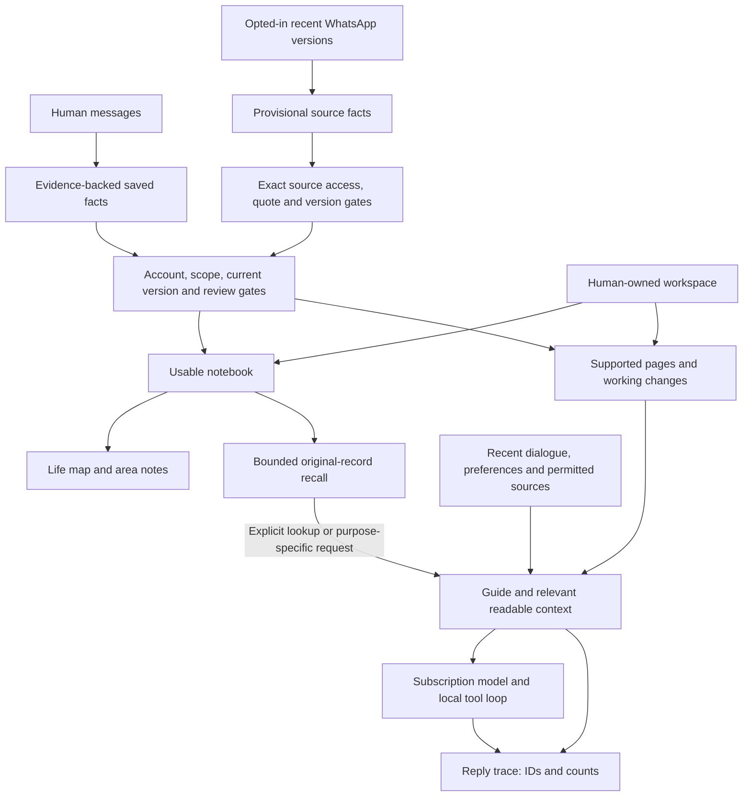

# Memory and context in 3PO

## The starting guide, spaces and scoped instructions

Ordinary chat receives a small 3PO information guide before changing clocks, relevant pages, working changes and source snapshots. It describes the assistant's role, where to find background or current information, the root spaces and topic routes. A space read returns its parent context and a bounded child index, so the assistant can descend to the relevant subspace. The guide's ordering and request JSON are deterministic. Its fingerprint and byte count are retained in Context details without duplicating guide prose.

The guide and stable assistant rules occupy an initial developer message. Captured request data is a separate developer message after the first actual human item in bounded history, keeping an eligible initial boundary while preserving human, image and tool payloads and their order. Both messages are frozen for the owned turn. Tool schemas remain stable for each supported workflow; a stable opaque cache key is scoped to account, model and purpose. The current subscription route accepts this layout and has reported real cache reads, but consecutive requests can still miss. Explicit breakpoint metadata was rejected by that route and is not sent. Provider cache residency and latency improvements are not guaranteed; supplying the guide does not depend on a cache hit. Usage distinguishes reported zero from an absent count and shows cache writes separately when supplied. A write count alone does not prove later reuse.

The Context sidebar has independently collapsible sections and nested spaces. Its rows come directly from canonical project identities, so an empty or new space appears without inference. Search reveals matching paths without changing saved filing or expansion choices. Short descriptions prefer the human's existing project-purpose note, then a currently supported AI synopsis. The space view shows a short description, human controls and child-description table; detailed maintained context stays available separately. Human descriptions are never overwritten by consolidation.

The guide has matching topic and instruction tables. Their short routing descriptions and exact read IDs come from one shared catalogue used by the screen, sidebar and AI directory. Every life area and Recent context has a topic route, including a local placeholder before its first maintained page. Existing saved topics keep their exact page identity and unavailable-support state when opened. Six feature routes lead to their original policy owners, including defaults and current feedback. Directory descriptions contain no factual topic prose or human policy body, so editing those contents does not rewrite the stable map. Reading a linked page still captures its actual current evidence and version. An unknown topic alias or page ID returns a bounded unavailable result without unrelated working context; search requires an explicit descriptive query with no page ID. Targeted source assessments keep their narrower existing context.

Each space and topic can have human-owned instructions in the same versioned page store. Space instructions retain their exact project/scope identity. Parent instructions apply to descendants; the most specific child guidance refines them and is retained first under the input bound. Exact page reads do not include sibling instructions. Current canonical ancestry is captured, so a move or a supplied instruction edit invalidates an in-flight read. Generated page maintenance receives labelled original ancestor context, without promoting parent context into a direct assertion about the child. Saved inherited prose retains exact filing dependencies separately from the model's chosen quotations, so moving a child or intermediate parent withholds its old inherited summary. These structural receipts do not require every ancestor's full notes in the bounded synthesis input. Instruction text remains excluded from factual learning and cannot grant source access or approve actions.

Purpose clarification is selective: active work or explicit active human context admits consideration, and the model must identify an important unknown purpose that affects current assistance, filing or planning. An empty description alone is insufficient. Completed/archive branches stay quiet; dismissed/answered concerns remain suppressed. Only currently actionable pending questions occupy the outstanding slot. Saving a human purpose note can acknowledge the exact matching pending question with a verified page/identity receipt, while preserving history. Existing daily question/learning controls remain.

## Context pages and working changes

Open **PA menu → Context**, **Settings → Context → Open Context pages**, or a project’s **Context** shortcut. Context is the primary memory interface: Overview, Projects, Topics, Working changes and Instructions. **Supporting facts and controls** opens the original evidence, correction history and learning controls when needed. Pages live in the existing local data store with stable account/project identities, exact supporting references and version history. Markdown is the readable body; the surrounding records carry provenance, permissions and save receipts. There is no separate folder of loose files to keep in sync.

Ordinary chat receives a small everyday overview, a compact directory, applicable feature guidance and relevant changes waiting for consolidation. Orientation has a separate allowance from matching project/topic pages, so two overview pages cannot crowd out the requested subject. The assistant can read a particular page, search for a relevant page or continue a long page in bounded excerpts. Topic and project pages help it find context as the notebook grows. Missing or unavailable context stays unknown. Original facts and evidence remain separately retrievable; a short summary does not replace them.

Ordinary chat does not automatically receive a parallel list of raw saved facts. The original records remain the evidence ledger for page updates, correction history and source checks, with explicit `read_memory` lookups when original detail is needed. Relevant recent changes can still appear before consolidation. Review conversations and the dedicated setup interview retain their purpose-specific original-record inputs. Removing the extra chat feed does not remove backing-page evidence, inherited history dependencies or exact action guards.

An idle, permitted automatic heartbeat updates affected pages with one bounded synthesis request. An explicitly requested heartbeat finishes the initial pending-page snapshot in serial bounded batches, under the same persisted call allowance. Changes arriving during that pass remain pending for the next run; Stop, ownership changes and failures stop the pass without repeating its attempted batch. Each page records the exact inputs successfully considered, separately from the shared working-change checkpoint. Work deferred by input or request bounds remains pending. An unchanged page needs no synthesis. Current original purpose and supporting records accompany later update windows; prior prose is only a drafting aid and cannot support itself. Cited support is stored separately from the inputs successfully considered. The browser shows saved pages, working changes, pending first updates and the latest maintenance failure. Eligible collected source deltas have an independent page cursor: ordinary source learning can finish first without hiding a change. Existing baselines, paused failed claims, source choices and global memory controls still apply. Collection and opening the page browser make no inference requests or source refreshes.

Human writing and generated summaries have separate owners. The browser edits everyday context, independent notes and descriptions of existing projects. Generated pages offer **Add context** without turning model prose into a human assertion. Source reports keep attribution and uncertainty. Source changes, corrections, Forget and access withdrawal remove unsupported summaries from future AI context. Saved history remains local; Restore creates a new version and does not restore withdrawn evidence or replay an operation. Pausing memory use leaves source-free human notes locally readable and editable.

Feature instructions use their own authoritative controls in the same browser:

- **Assistant**, **Projects** and **Reminders** have human-owned Markdown instruction pages with defaults and history. These preferences guide the relevant feature; they never grant access or approve actions.
- **Brief instructions** opens the existing brief-writing prompt.
- **Review guidance** combines an editable, versioned selection policy with the current canonical feedback preferences. Feedback retains the original human words and its existing editable interpretation; it is not copied into a second preference store. Routine broadcasts and marketing stay quiet unless supported personal relevance or explicit human priorities justify informational reading. A new direct personal request remains eligible.
- **Calendar guide** describes each exact permitted calendar, bound to its account/provider identity. Fresh calendar reads and proposal planners include the guide and bounded existing human calendar guidance to choose a supplied writable destination. Earlier human guidance remains in its original evidence record and is shown in the guide without creating a second editable purpose note; generated summaries and source interpretations cannot provide routing instructions. A matched destination is saved by exact identity and shown before approval; missing or ambiguous purpose uses the ordinary default. Approval executes the captured payload without inference or rechecking later guide wording. A description never authorises an action.

When understanding an existing project would materially help, consolidation can offer one neutral purpose question in Review. Questions follow the optional learning-question control and share its one-new-question-per-day allowance with conversation learning. They preserve exact project identity and do not repeat after dismissal or an answer. An answer becomes editable human project context; it does not rewrite project notes or create a task. Dismiss supports local Undo.

Page and instruction reads capture the versions actually supplied. Editing unrelated data does not cancel a request; changing supplied knowledge or withdrawing its access does. A request can finish its own verified memory/project change while still rejecting an independent edit of the supplied human page. These are context checks, separate from the exact authority and readback required by native actions. Saved Review cards and dated briefs keep their existing prepared-display rules.

## Shared working context — 16 October 2026

Chat, Review conversations, setup, briefs, email assessment and both reply-draft paths, proactive planners and retained project-placement jobs use page context with exact receipts. Page relevance is selected independently of the original fact-search result; every supporting record must still be available under that feature’s current consent. Email classification/drafting sees human/project-supported pages, with separate small header/body bounds, and no raw source or conversation-change feed. Brief and suggestion permissions remain distinct. Inactive Projects are excluded before email’s project budget. Memory-off withdraws historical preference-backed relevance.

Page synthesis receives bounded original records as ordered passages. It returns one typed preparation result using short issued page choices and a single enumerated passage selector for each evidence item; the app maps those choices to the captured exact original identities/versions and attaches the untouched source text locally. The page-specific result schema offers only passages actually supplied for that page; source and passage fields cannot disagree. Invalid, missing, duplicated or cross-record choices fail without acknowledging pending work. The combined batch data and result schema stay within the existing bounded input allowance. Passage coverage and omitted original tails are explicit; a bounded excerpt is never reported as reading the full original. Previously saved exact quotations remain compatible.

Original fact extraction, source learning, correction review and organisation work on canonical evidence and identities. They produce the records consumed by page consolidation; generated prose never becomes fresh evidence. Intent verification, source collection, saved display, page inspection and prepared approvals do not start context inference. The original record and typed-link readers remain evidence and compatibility tools, while pages are the primary prose workflow.

A short referential timing/status question may reuse the immediately previous human request as retrieval subject. New distinctive subjects do not borrow old queries; synthetic labels never become search terms. Optional reply traces record purpose, source-hint categories and whether a follow-up used that subject, alongside the existing exact IDs and tool names. They do not record reasoning or prove which fact influenced the model.

New and converted Review preferences are canonical PAMemory. One atomic conversion preserves legacy account/IDs/direction/inactive state and exact original receipt provenance, writes canonical facts plus a conversion receipt, then removes the old reviewRelevancePreferences record. Runtime consumers no longer load or edit the separate preference store. Restoring identical old bytes cannot resurrect forgotten/edited memory; unknown semantics/collisions/save failures preserve the original and expose a conversion error. The conversion proof validates historical receipts only, never supplies a second retrieval store. General assistant writing instructions remain an explicit app setting.

Retrieval adds bounded grammatical/spelling variants, eligible human-written parenthesised abbreviations and distinctive-term ranking. No embedding model or hosted search service is introduced. The existing AI can request targeted alternative memory-search wording using its existing tools; actual-model rewording quality is validated separately from deterministic lexical tests. Pending cross-source concerns are selected for relevant comparison with fair reconsideration; exact native duplicate edits/removals share the same captured baseline. Arbitrary new creations still need semantic judgment; no title-only identity merge or automatic project/commitment-group authoring occurs.

## Saved output and current reasoning — 13 October 2026

Review cards and saved briefs display the prepared result without rerunning supporting-memory, source-content or native-item freshness checks. Explicit account/source access changes still apply immediately. Evidence inspection happens on demand. A later heartbeat can reassess and retire a suggestion with a saved reason; approving a concrete displayed creation authorises that action without another memory analysis. Exact target checks remain for edits/removals. New AI reasoning, automatic advice and source learning still use current permitted evidence.

## Current heartbeat learning policy — 13 October 2026

The user confirmed that sources already allowed for review may teach memory. Current review permissions or an existing explicit learning opt-in permit bounded source deltas; global saved-memory and learning controls still apply. A new inherited source scope baselines existing content. Learning and recall use the same exact current source permission/evidence projection, including collected Mail account/header versions and observed body changes. Revoking review permission removes inherited access unless a separate explicit learning choice still permits it.

One fair automatic learning lane is offered within an owned heartbeat after email review. Existing shared budgets and failed-claim pauses are preserved. Source learning attaches supported existing area metadata inline; organisation never creates or restructures human projects. Reception/collection remains no-AI. Older dated descriptions of entirely separate review/learning consent are superseded by this explicit direction.

The PA has a saved notebook and builds a smaller working context for each request. The Life map shows the usable notebook and your workspace. It does not show every cached message, saved transcript or input used by an AI request.

[Documentation](../README.md) · [Feature tour](../guides/FEATURES.md#memory-and-setup) · [Architecture](ARCHITECTURE.md)

## The short explanation

**Collect → remember → connect → recall → maintain.**

1. **Collect:** permitted conversations and source changes supply evidence. Collection itself uses no AI.
2. **Remember:** save useful preferences, context and commitments with their origin, dates and certainty. A source report remains attributed to its source.
3. **Connect:** link facts to people, life areas and your durable projects. You can explicitly connect remembered reports about the same plan. Projects keep their own stable identities; memory is associated with them rather than copied into another brain.
4. **Recall:** select current, permitted facts and relevant project context for this question. Keep original evidence available for checking.
5. **Maintain:** version corrections, revisit unpinned organisation, resolve remembered commitments and retire outdated human context from recall while retaining evidence. Forget is the separate deletion action.

This is the organising model. Conversation learning and currently permitted WhatsApp, Calendar, Reminders and Mail learning can create lasting provisional facts. Source learning follows review permission or an explicit learning opt-in, subject to the global memory controls and a baseline for newly permitted content. A bounded human-memory review can propose duplicates, conflicts or old provisional context to retire. It does not automatically merge identities, choose a conflict winner or retire/delete facts. Nothing in this explanation claims every input has already been learned.

## Inspect it in the app

Open **Context → Supporting facts and controls** for the original record inspector. Opening, searching or previewing recall makes no AI request and does not refresh sources. The sections below describe that supporting ledger, rather than another primary memory workflow.

- **Overview** explains the layers, counts saved records/current versions/available records, lists exclusion reasons and previews saved-fact selection for a question and Focus.
- **Facts** shows original facts, certainty, evidence and dates. View version history, confirm, edit, organise, resolve, retire/restore human context, or forget a fact. These are explicit local operations; resolving memory does not complete a Reminder.
- **Life areas** groups currently usable facts and workspace anchors. Select an area to inspect its facts and recorded relationships. Area branches navigate the notebook; they are not inferred relationship claims.
- **Life map items** are actual saved spaces and tasks. Older area/course/project/heading/resource kinds remain compatibility metadata; richer memory entity types remain separate. Opening an area lists the same counted entries with their type and parent path. Open an entry to browse its contents, then return with Back. Remembered concepts and facts are labelled separately. Opening makes no AI request or edit.
- **Review** offers possible duplicates, conflicts and retirement candidates with their exact saved facts/evidence. Review now is explicit; weekly background review is optional/off by default. A changed fact invalidates its proposal. Inspect/correct duplicates or conflicts; retirement is a separate reversible human choice. Dismissal supports Undo.
- **Controls** contains the memory-use, human-conversation learning, optional question and existing-fact organisation controls. Source learning may inherit current review permission or use its explicit source opt-in; global memory controls, selected sources and new-scope baselines still apply.

Foreground replies offer **Sources & searches**, alongside **Context details** in the reply menu. It records direct fact-input IDs separately from evidence backing page context, additional supporting reads, page IDs, dialogue/excerpt counts, workspace IDs, model, Focus and whether a cached source snapshot was prepared. An evidence identity does not mean its raw record was separately supplied. Older traces combine original fact inputs and backing-page IDs; their display explains that the split was not recorded. New replies additionally save bounded lookup terms, date/folder filters, returned page IDs/counts and lookup outcomes. Tool names mean attempts; verified changes remain in their existing receipts. This explains prepared inputs and actual lookups, not model attention or reasoning. Older replies have no invented search history.

The trace stores a bounded retrieval question and allowlisted lookup terms/filters, plus identities/counts. It copies no source bodies, memory prose, full prompts/tool arguments, action authorisation, credentials or model reasoning. Current account/source choices gate query inspection; content updates alone do not erase historical lookup metadata. Inspecting an ID opens its current permitted version, which may have changed or become unavailable. A trace holds at most32 lookup rows/16KB, with an omitted count, without capping tool execution or removing operation identities.

## Feedback about what deserves review

14 October correction: feedback uses captured source choices and exact email ownership during interpretation. Calendar/Reminders collection notifications are unrelated to that email and do not invalidate it. Explicit retries retain the issued memory identity; a verified save resolves the earlier local alert without rewriting failure history.

Feedback on an email now uses one explicit, bounded subscription request to reason from your comment, the selected topic, and that exact email's sender, subject and up to 16,000 body characters. The **learned preference is the primary memory**, rather than a verbatim copy of an ambiguous comment. Original human words remain evidence. For example, ‘These emails aren't important’ on a general university broadcast can teach that routine newsletters from that communications team should stay quiet, while a new personal request or obligation still matters. Explicit sender-wide human wording can set a broader scope.

**Submit feedback** retains your words locally and closes the dialog immediately. Submissions wait for the next heartbeat, which processes at most one queued submission per cycle. **Process now** requests immediate priority through the same serial coordinator, waiting for other PA operations to finish. You can switch pages, including opening the assistant, while it learns. The card shows progress and the saved preference; Review preferences retains unfinished feedback even if its card leaves the inbox. A targeted Stop stops only that submission. Foreground typing/sending cancels active feedback and interrupts queued submissions, keeping their words for an explicit retry.

Review preferences and Memory expose the same canonical preference, its original feedback and email-context metadata. You can edit it directly, Disable/Restore it or inspect history. Changing the original comment/topic clears its old interpretation. Opening these panels makes no inference or source request. Interpretation reads the exact email before and after inference and rejects changed content/account/header/assessment/source controls/model/memory or foreground cancellation. Failures offer **Retry learning** and the explicit **Save only my words** fallback; there is no silent downgrade or automatic retry. Never-started heartbeat-eligible submissions remain queued after reopening; attempted or interrupted submissions retain their words and require explicit retry. Pending feedback is not a recall fact. Exact issued memory IDs prevent duplication if the memory save succeeds but recording its completion fails. Inference requests one completed typed `pa.interpret_review_feedback` result through the existing subscription protocol, with no action execution or extra inference round. A plain-text preference cannot silently become a saved rule. The decoder accepts a complete JSON code fence and otherwise reports a feedback-specific format error without exposing a raw Cocoa decoding error. Dismiss remains acknowledgement only.

The interpretation stores header and exact identity/version receipts, not the email body or model reasoning. It is human-authorised policy with separately labelled inferred scope, not a new source-derived life fact. Future matching uses the reasoned preference and sender/purpose context within existing bounded local retrieval and exact memory dependencies. Sender domain suffixes alone do not seed matching. The policy survives loss of the example email; inferred unconfirmed preferences retain the existing 90-day review boundary. Changing a learned preference to another memory type retains a correction version and its evidence while removing review-only metadata. Existing preferences and histories are preserved without automatic rewriting or consolidation.

## The structure

| Layer | Durable record | Authority and purpose |
| --- | --- | --- |
| Human conversation | Account-owned messages with original IDs, optional legacy scope, Focus and interview tags | Current human intent can authorise a supported change. Historical dialogue alone does not authorise a new change. |
| Human memory | `PAMemory`: preference, context or commitment; stated/inferred, stable/situational, evidence, dates | Useful personal knowledge. Confirmed/stable stated facts persist; provisional interpretations remain distinguishable. |
| Source memory | The same `PAMemory` type with exact source identity/version/quote and optional supporting evidence/report state | Attributed source interpretation, separately permission-gated; never human assertion or action authority. |
| Belief history | `supersedes` / `supersededBy` between unchanged record identities | Current belief is used; old wording/evidence stays inspectable. Restore makes a new current version. |
| Organisation | Optional areas and typed endpoints referring to the fact's existing connections | Navigation and recall metadata. Manual organisation is pinned; organisation cannot invent a fact. |
| Workspace | `LifeWorkspaceStore` human-owned spaces (with optional notes), tasks and exact source pointers; legacy kinds retained | Editable durable content, with hierarchy/order/tombstones. Mentioning a project is not permission to create one. |
| Notebook / map | `LifeNotebook` plus canonical workspace-anchor projection | Derived usable facts and exact workspace identities. It is rebuilt locally, not another independently editable memory database. |
| Context pages | Versioned `ContextPage` Markdown, exact supporting references and per-page progress | Human writing and generated projections have separate ownership. A page cannot override canonical evidence, permissions or action receipts. |
| Working context | Guide, relevant pages and pending changes, dialogue, human guidance, cached snapshots and explicit tool results; purpose-specific original records where applicable | Bounded information for one request; ownership is captured before inference and checked before outputs/actions. |
| Reply trace | Optional `AssistantTurn.contextCapture` | Bounded lookup terms/filters and returned IDs/counts for inspection; separate from source-dependency guards and action receipts. |

## Saved, current, available and selected

**Saved** includes old versions, resolved commitments, facts needing review and source-derived records outside current access. **Current** means no newer version supersedes it; that alone does not make it usable.

**Available** additionally requires the active registration, permitted scope, no resolution/invalidation, any required provisional review, and current source access for every retained quote. Inferred/situational context needs review after 90 days. Stable directly stated human facts are retained. Source cache loss is unavailability, not evidence of deletion or completion. Turning memory use off selects no saved facts; the records and their saved states remain inspectable.

**Selected** is the smaller set supplied for a particular question. A targeted query must match useful words, a recorded connection within two hops or an explicitly human-linked plan. It can select **zero facts**; unused capacity is never filled with an unrelated biography or pinned preferences. The supported self-name is excluded from query terms so addressing you by name does not retrieve your whole life. Focus changes ranking within relevant candidates. A non-null empty, filler-only or own-name query selects no facts or workspace anchors; explicit null requests broad orientation. Literal AI, ML, CV and UK remain searchable. Certainty/kind/scope and review date break ranking ties. The input remains capped at 40 records and 20,000 UTF-8 bytes.

A null query explicitly asks for bounded broad orientation, including a small core of confirmed preferences. The daily brief uses this broader day-planning context. Memory/notebook tools expose null for a deliberately broad life overview or setup; ordinary foreground questions have a targeted query. Background source suggestions without a query receive no memories. Email classification selects human facts from its subject, sender and bounded body; actual reply drafting additionally looks for writing-style preferences. Source facts remain excluded from email classification/drafting because that lane has no source-memory receipt. Review batches build a bounded query across the supplied emails/messages, rather than truncating everything after the first long message.

This is local word/typed-link retrieval, with no extra AI or embedding call. It improves precision but cannot guarantee semantic relevance, recognise every synonym or separate unrelated clauses within one saved fact. Those remain quality work, not a claim of perfect recall. Its local explanations come from the same ranking pass as the production selection.

8 October email relevance extension: targeted human-origin recall and current human workspace anchors now reach the header gate as well as body assessment. Header/body caps are respectively two/six facts and two/four anchors, with two/four matching explicit attention preferences. Notebook anchors share the selected human-fact IDs and require query relevance or a supported link. A positive email connection stores exact belief fingerprints, workspace/preference revisions and a source quote; current consumers remove stale boosts and reject advice using changed assessments. Source-derived facts remain excluded from classification until its own source-memory dependency contract is implemented. Review attention preferences are separate editable account-owned records, never source-authored Life-map facts or inferred completion. Historical 8 October behaviour also supplied weak dismissal examples. The 11 October change supersedes that part: Dismiss is exact acknowledgement only, and explicit human feedback teaches importance.

Recall and notebook context now use the same canonical workspace projection. A query matching a saved item's current label can favour its associated current facts, including facts whose prose still uses an earlier project name. Exact identity bindings preserve typed endpoints; ordinary memory references add associations without asserting identity. Saved references can follow a usable correction lineage; the original reference/evidence is not rewritten. Ambiguous same-name items are not merged, deleted items are excluded, and no unavailable, retired or superseded fact is made usable by a project link. Project details expose those current facts and their evidence. This is explicit/typed association retrieval, not semantic alias resolution.

The notebook is a second bounded input: up to four areas with six facts each, plus up to twelve workspace anchors, within 8,000 bytes. Targeted notebook facts are restricted to the same selected IDs, so the smaller notebook summary cannot reintroduce unrelated facts or bypass the selection budget. Anchors need a query match or a link to selected facts; linked-fact IDs are restricted to the selection. A small known-area/count index remains available for navigation. Broad overview can still explore the bounded notebook/workspace. The universal self node is not a traversal bridge to every area. Focus is a relevance preference: it can draw on other relevant areas and never grants source access. In a Focus conversation this account's usable earlier-topic memories are available; legacy queued/thread work retains its captured scope. Context details separately exposes notebook IDs and later memory reads.

The Review inbox's **Memory supplied** list is the captured context of the review batch, which may assess several messages. It is not proof that a fact influenced a particular suggestion. Existing dated receipts retain the facts originally supplied, even after retrieval improves; inspecting an older 15-fact suggestion must not silently pretend only today's smaller selection was supplied. New checks use the narrower selection. No fact is forgotten, corrected or removed merely because it is irrelevant to one task.

Recent dialogue is also bounded: up to twenty eligible completed turns and 24,000 bytes, with human dialogue prioritised over background deliveries. Earlier turns may be marked excerpts. Full visible history is kept separately. Source-dependent old assistant prose can be omitted from future AI history when its dependencies are no longer usable, without deleting the visible transcript.

## Evidence, corrections and source changes

Human memory points to the original statement. Source memory points to an exact account/container/message/linked identity, literal quote, content revision, message date and observation time. Up to three quoted versions support a source claim. Same-chat newer source updates can replace a provisional belief while retaining earlier evidence. A human-confirmed/human-origin fact is not silently overwritten by a source report.

Source states such as proposed, accepted, changed, cancelled or completed are attributed reports. A proposal is not automatically the user's obligation. A cancellation is not automatically a Reminder deletion. Calendar/Reminders tools still require understood current human intent, fresh exact record identities and verified native readback.

For useful recipient requests or explicit status reports about relevant responsibilities, native source learning can preserve a report while the recipient's identity is unknown. It describes what the sender asks or reports without assuming the recipient is the user or the user accepted. General saved project context does not duplicate a new exact source-reported state. Each report remains attached to its own source; a cancellation or completion never resolves a different item by similar wording. Insufficient or irrelevant evidence may still produce no facts.

Human corrections atomically link the old and new beliefs. Current-belief Forget removes its lineage and suppresses its original learning evidence. Forgetting one explicitly selected historical version has narrower semantics. Dependent source quotations become unavailable; local Undo preserves independent Forget owners. The inspector follows a lineage in either direction without changing those deletion rules.

**Retire from recall** applies to current human-origin preferences/context. It saves `retiredAt`, retaining the same fact ID, prose and evidence. Retired facts leave saved-memory retrieval, the Life notebook and placement/organisation inputs; their projects, workspace links and original messages stay unchanged. **Restore to recall** clears retirement and records the human review, without turning an interpretation into a confirmed fact. Retirement persists across restart and cannot be silently undone by re-extracting the same human evidence. It does not erase independent recent dialogue or source context. Commitments use Resolve/Reopen; source beliefs keep their evidence/version/permission lifecycle.

The organiser first classifies unorganised human facts, then may reconsider unpinned classifications after 30 days. This is a conservative product interval, not a research-derived optimum. Manual **Organise now** can revisit sooner; existing eight-fact batches, two automatic passes/day, shared four-pass learning allowance, cooldown and paused-failure guards remain. Classification review is separate from a fact's evidence/review date: it never renews provisional truth, rewrites prose, merges facts, retires them or edits project content. Manual classifications remain pinned.

## Why this direction

The recommendation is a hybrid of evidence history, current facts, stable entity/project links and bounded working context. This is an engineering synthesis, not a claim that one benchmark proves the best PA architecture. [LongMemEval](https://arxiv.org/abs/2410.10813) makes updates, chronology and missing-information handling testable. [RecMem](https://arxiv.org/abs/2605.16045) supports evaluating selective consolidation rather than paying for every incoming interaction, while acknowledging that recurrence can miss important one-off events. [ScrubJay-MEM](https://arxiv.org/abs/2608.04746) supports separating perishable context from lasting knowledge; its results worsen on some consolidation tasks. [Zep](https://arxiv.org/abs/2501.13956) is a reference for connecting historical evidence to changing structured knowledge. We preserve exact identities and reversible history first, then measure semantic matching before expanding it.

Native adapters now emit exact bounded versioned evidence into separate account-owned assessment lanes, with baseline, pending and assessed cursors. These coordinate with WhatsApp learning through the shared learning allowance. An urgent one-off deadline must not wait for repetition. Missing access is unknown, not completion. AI maintenance may organise metadata and propose conflicts, duplicates or obsolete context; human-owned projects and confirmed memories retain their stronger authority. The map should expose current beliefs, their relationships and project anchors, with review/history accessible, rather than becoming a separately maintained store.

## Source coverage and background work

Source collection is separate from interpretation. **Refresh sources only**, Mail arrivals, WhatsApp reception and opening an inspector make no AI call. **Run heartbeat** (Command-R) explicitly starts AI analysis. Automatic learning checks eligible deltas through the owned heartbeat learning lane or the existing eligible learning coordinator; source refresh never learns. Conversation learning, optional source learning, existing-fact organisation and optional weekly review share four automatic passes/day with a 30-minute cooldown; failed or interrupted work remains paused for explicit continuation.

WhatsApp source learning currently assesses up to eight recent waiting versions with bounded neighbouring/saved evidence. Exact assessment receipts and pending references distinguish received, assessed and unavailable content. It does not sweep history or learn from every conversation. Mail is read-only through the native bridge; Cambridge Graph permissions are unavailable. Calendar, Reminders and Mail retain separate default-off explicit opt-ins in Settings → Memory; current review permission can also enable their bounded learning under the global controls. Calendar consumes fresh 90-day orientation (up to 200 occurrences), Reminders fresh incomplete items (up to 200), and Mail exact retained quotations from matching selective assessments with a body check within 24 hours (among at most 200 current headers). The native cache must have a successful read within 30 minutes, current permissions and enabled source filters. Missing/ambiguous provider identities are skipped.

Each new opt-in establishes a baseline instead of indexing existing content. Automatic passes assess newly changed/recent versions; Review once explicitly permits one existing batch. Native changes waiting for quota remain pending while available. Lost pending versions are counted; old changes returning to a partial window remain baseline unless a fresh Mail body check verifies a known changed version. No extra source/body reads are initiated by these learners. Max eight inputs/four facts per pass, 12 KB source text/24 KB full input. Failed or interrupted claims remain paused, and exact assessment receipts prevent replay after a separate cursor save fails.

Calendar memory identity is independent of dashboard occurrence IDs: native item ID for single events, provider external ID plus original occurrence date for recurring/detached occurrences. Distinct occurrences remain distinct; missing or colliding identifiers abstain. Provider identifier changes after a sync/calendar move can make prior evidence unavailable; no title-based stitching is attempted. Native same-item revision updates can retain the same start/due/received date or move it earlier. They require the issued old evidence, a different current revision and a later observation. Earlier quotes remain version history; new native beliefs depend on the new exact version, not stale quotes. Existing WhatsApp chronology/multi-message support rules remain separate.

## Code and storage ownership

- `PAMemory.swift` defines facts, evidence and recall ranking. `PAMemoryStore.swift` owns the `paMemory` SwiftData cache envelope, correction/Forget transactions, permitted projection and notebook selection.
- `LifeNotebook.swift` builds area/entity/link notes; `LifeCanonicalNotebook.swift` projects durable workspace anchors. Original facts remain authoritative.
- `MemoryInspection.swift` explains the same recall gates. `MemoryInspectionView.swift` renders local inspection. It has no persistence, source refresh or inference path.
- `AssistantService.swift` assembles one initial selection and notebook context for both the request and its trace. `Conversations.swift` keeps the optional trace on the existing turn in the canonical conversation metadata/chunks; the original legacy `assistantConversations` bytes remain preserved.
- `PAToolSession.swift` records successful memory-read IDs separately from issued IDs. Issued IDs still control mutation safety; the trace grants no authority.
- `NativeSourceAdapters.swift`/`NativeSourceProjection.swift` project only fresh permitted cached data. `NativeSourceLearning.swift` owns bounds/baseline/decode; `NativeSourceLearningService.swift` owns account opt-ins and `paNativeSourceLearning` cursors. This envelope contains opaque hashes/references, not source text.
- `MemoryMaintenance.swift` selects bounded human facts and validates proposals. `MemoryMaintenanceService.swift` persists review controls/cursors/proposals in `paMemoryReview`; proposals never execute fact changes. Source learning, usage accounting, brief/proactive services and the queued-work store retain independent responsibilities.

The SwiftData cache is local Application Support data, excluded from Git. ChatGPT registrations live in Keychain; WhatsApp auth/message/name stores are encrypted with a Keychain-held key. Derived memory quotes and other SwiftData context are not all encrypted today; extending encryption and measuring deletion/retention coverage remain planned work. This is a personal development app, not a claim of a complete encrypted vault.

## Current limits

The existing structure supports an inspectable, evidence-backed notebook. It does not yet provide reliable global aliases, semantic consolidation, a complete temporal commitment episode across email and WhatsApp across all consumers. Broader source coverage, semantic aliases/actual consolidation, sustained multi-turn quality evaluation, global background coordination and checkpointed delegated artifacts remain open. New automatic briefs/Tasks can use permitted source facts with persisted exact belief and communication receipts. Their source controls remain independent; historical outputs without receipts retain their existing behavior. Offline inference is later. The [developer guide](../development/DEVELOPMENT.md#choose-the-right-checks) explains the scope and limits of memory verification.

GPT-6 Luna exists in OpenAI's current [model documentation](https://developers.openai.com/api/docs/models/gpt-6-luna). Availability for this app is determined by the selected account's [subscription model catalog](https://developers.openai.com/siwc/token-sharing-open-source/models-and-inference), not by the Codex picker or API pricing page. **Settings → Connections → Refresh models · no AI** refreshes that catalog without changing the selected model or making inference. The separate access check explicitly spends one source-free request.

## Advice remains accountable to its context

New briefs and suggestions persist `memoryDependencies` alongside their existing records. `AutomaticMemoryContext` obtains one production selection and applies feature-specific permissions; `MemoryDependencies` hashes each supplied belief/evidence version. Native/WhatsApp permission projection and usability still govern validation. Metadata classification/review bookkeeping is omitted from the saved belief fingerprint; retirement, expiry, correction, resolution and source withdrawal remove usable support.

In-flight work compares the actual captured selection as well as its receipts. New reasoning and eligible inference input check only supplied dependencies, so unrelated new facts do not invalidate them. Saved prepared Review display and concrete creation approval follow the separate policy at the top of this document. This is deliberately conservative: all supplied facts are dependencies, not only facts cited or demonstrably attended to. It is an inspectable input receipt, not a model-reasoning trace or human-write authority.

Mail outputs also capture their exact assessment/body/reply version. WhatsApp outputs retain opaque conversation-cache receipts for chats present in raw input or selected source facts. New replies/edits/cache loss invalidate the old context; this avoids assuming an unchanged original request is still current after a cancellation. Changes in an unrelated, unselected chat do not participate. These are bounded cache checks, not semantic commitment linkage or proof of a task state.

The immutable morning record and latest widget update remain dated saved output. New update context, current advice, recovered discovery delivery and notifications reject unavailable support; visible history stays saved while unusable output leaves future inference input. Saved Review cards remain visible under current source/account access. Approval of a prepared creation validates its concrete payload, destination, duplicate/uncertain receipts and readback; edits/removals retain exact target/current-field checks. A fresh explicit Update has the same original morning anchor and never creates a second morning delivery. Memory supplied in evidence panels exposes matching current receipt facts and explains unavailable ones. Older records decode without invented receipts. No additional AI or source reads originate in validation/inspection.

## Remembered reports of a plan

In Facts or a Life map commitment's detail, open **Remembered plan reports**. Each report keeps its exact evidence, attribution, source date and version. **Connect another report → Yes, same plan** makes a local, human-reviewed identity connection between two currently usable commitments in the same account/scope. **Keep this report separate** removes that member's connection. Neither operation confirms the reports, picks a truth winner, changes their wording/review date, resolves a memory or edits an Apple/project item. No inference or source refresh is involved.

Independent Mail and WhatsApp reports stay separate even when titles, dates or participants look similar. A source learner cannot assign this identity. Only a validated source supersession or same-scope human commitment correction inherits an existing connection. Kind/scope changes clear it. Forget and resolution preserve their existing meanings; restoring an earlier version cannot undo a later explicit disconnection. Two already-established groups cannot be silently merged. A group has at most 12 current reports.

Relevant connected reports receive a local recall boost only after account, scope, source permission and usability filtering. PA, brief and suggestion inputs include an additional plan index over the **same selected facts**: at most 12 groups/4 KB, exact fact IDs and attributed reported states, with mixed/unknown states marked uncertain. It adds no historical prose or unselected facts. Partial retrieval can omit reports; it never proves a full commitment history. A later date alone does not establish supersession across sources.

Group identity/revision is included in each fact's advice fingerprint. A local membership, report, version, resolution or Forget change revises remaining current group members, setting dependent advice aside even if it supplied only another member. Review/classification bookkeeping does not revise that claim set. Permission loss still follows the selected fact's existing live evidence gates; inaccessible claims never enter the index. Native source learning now accepts the same optional proposed/accepted/changed/cancelled/completed/unknown attributed report state as WhatsApp; legacy records without it remain unknown. Source-reported status never becomes Apple task status.

This is a human-reviewed connection foundation, not automatic semantic episode matching, cross-source cancellation adjudication, project/event identity stitching or a complete temporal ledger. Natural-language PA memory-connection tools and richer episode timelines remain future work. Communication review now supports inferred, evidence-backed native date-change proposals without a manual plan connection, but does not establish a permanent canonical episode/native binding.

## Inferred suggestions and confirmed connections

A useful suggestion need not wait for a manually connected memory group. The communication reviewer can compare distinctive recent message context with exact issued native records and prepare a date-change proposal in Review inbox. Its match explanation is explicitly inferred; ambiguity declines the edit. The user reviews the original item and approves a fresh, revision-checked save. This proposal does not merge memory claims, confirm a source report, change a project or create a global plan identity. Human-reviewed plan reports, source version history and actual Calendar/Reminder state retain their separate meanings.

Quiet/reported source assessments now have opaque persisted communication-review receipts. These say what was assessed under that context, not that all received content became memory or that an action was completed. Memory learning retains its separate opt-ins/cursors and budget. See [How it works](HOW_IT_WORKS.md) for schedules and approval recovery.

Life map fact details also show the existing recall status (available, earlier version, retired, resolved, needs review or source unavailable) and expandable version history. When memory use is paused, an otherwise available fact is labelled as paused. The map shows the latest 12 versions; Manage memories retains the full history and edit/restore controls. Original quotes remain hidden when the source version/access is unavailable. A saved belief is separate from a human-owned project or an Apple reminder.

## Reliability preparation changes — 11 October

The integration in progress retains deterministic lexical/typed-link retrieval. A per-revision lexical index avoids tokenising the same saved facts for every ranking comparison. A notebook preparation cache is guarded by account/topic, supplied record IDs, currently usable IDs, memory revision and the workspace projection revision. Permissions and temporal usability are checked before every lookup; a projection without a revision provider is rebuilt. Corrections, feedback, source revocation, expiry and project changes cannot keep an old cached notebook current. These are rebuildable in-memory metadata, not new saved beliefs, semantic embeddings or model attention.

Dedicated setup explicitly requests null-query broad memory orientation while excluding its cached source snapshot. Ordinary PA messages retain targeted queries. The fixed fictional memory suite reproduced twenty-two short-query/Focus failures before the fix and now passes sixty-four contracts. Its separate two paraphrase examples still retrieve zero of two relevant facts, with zero distractors. This records a semantic limitation, not an implemented synonym or alias system.

## 16 October — request dependencies and memory saves

The memory store exposes a separate control generation for actual memory/learning permission changes. Ordinary fact saves and unchanged setting assignments do not change it. Each AI consumer validates the bounded facts it supplied, including current belief/evidence and any issued replacement candidates; it does not rerun retrieval and require the whole resulting selection to match. Maintenance and organisation retain exact issued record snapshots, eligibility and human pins.

Source learning and organisation save synchronously after exact validation against the current envelope revision, preserving unrelated local saves. The underlying loaded-byte compare-and-save is retained for separate writers. Replacement of old native source memory checks its unchanged issued snapshot and exact current source batch, rather than requiring superseded evidence to be usable for new recall. WhatsApp context dependencies follow the prefix actually retained by the bounded input builder. Genuine controls/account/model/source/Stop conflicts still reject; attempted failed learning remains paused across reopening.

## 17 October: concurrent changes while context is being used

The current request keeps its captured model, style and Focus. Allowing new memory learning is separate from reading already permitted memories, so changing learning permission does not cancel a read-only reply/brief. Conversation learning validates only the selected current facts, exact supplied correction history and suppression for its captured batch, then merges into current state under storage CAS. Unrelated memory edits or proposal Dismiss/Undo survive that merge. Turning off questions only withholds a new question; supported facts can still save.

Permission withdrawal, edits to supplied beliefs, correction/Forget lineage and exact operation conflicts retain their checks. Optional source dependencies are acquired from actual supplied context or later reads, rather than the mere existence of a connected source.
